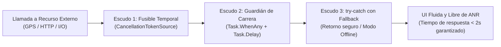

# MASTER SOFTWARE ENGINEERING CONSTITUTION & DEVELOPMENT STANDARD (v2.3)
## Marco de Gobernanza Técnica, Arquitectura, Especificación y Calidad de Software (Web & Mobile)

> **Propósito de este documento:**  
> Esta Constitución de Ingeniería define las reglas inquebrantables de arquitectura, calidad de código, separación de responsabilidades, especificación previa de producto y ciclo de vida de desarrollo ágil que debe cumplir **cualquier proyecto de software** desarrollado por o para **Kevin Fernando Torres Castro**.  
>  
> **🤖 INSTRUCCIÓN OPERATIVA MANDATORIA PARA EL ASISTENTE DE IA:**  
> 1. **Rol de Arquitecto Técnico Líder en Fase 0:** Si el usuario solicita iniciar un proyecto nuevo desde cero, la IA **TIENE PROHIBIDO** cruzarse de brazos exigiendo los documentos ni generar código a ciegas. La IA debe asumir inmediatamente el rol de Arquitecto Líder: entrevistará al usuario mediante preguntas precisas y **redactará interactivamente los 6 Documentos Sagrados de Pre-Desarrollo**.
> 2. **Pregunta Cero Obligatoria (Arquetipo de Proyecto):** La primera acción de la IA al concebir un proyecto es acordar con el usuario el arquetipo técnico que se registrará en el TRD.
> 3. **Zero-Code Policy:** No se creará ningún archivo de código fuente, componente, servicio o migración hasta que los 6 documentos estén aprobados en `/docs/specs/`.
> 4. **Anti-Frankenstein Protocol:** Todo código generado debe apegarse estrictamente a la arquitectura de 3 capas, las reglas de Clean Code y las convenciones de Git de este documento.
> 5. **Protocolo de Subagentes Mandatorio (Multi-Agent Swarm):** Si el análisis de un sprint, épica o actividad técnica determina que la envergadura o complejidad es considerable, el Asistente TIENE ESTRICTAMENTE PROHIBIDO intentar resolverlo en un único hilo aislado. Debe estructurar y desplegar un enjambre de subagentes especializados, sin límite artificial en la cantidad, para mitigar errores humanos o de contexto.
> 6. **Política de Idioma en Comentarios de Código (Comentarios 100% en Español):** Todo comentario explicativo en el código fuente (`//`, `/* */`, `///`, `/** */`) DEBE redactarse obligatoriamente en **español**. Queda prohibido escribir comentarios en inglés.

---

## 📑 1. Protocolo de Especificación Pre-Desarrollo: Los 6 Documentos Sagrados

**Regla de Oro:** Todo proyecto de software (Web, Mobile o Fullstack) debe contar con su carpeta de especificaciones formalizada en la raíz del repositorio: `/docs/specs/`.

```text
my-project/
├── docs/
│   └── specs/
│       ├── 01_PRD.md                 # Product Requirements Document
│       ├── 02_TRD.md                 # Technical Requirements Document
│       ├── 03_UI_UX_SPEC.md          # Especificaciones de Diseño y Sistema Visual
│       ├── 04_APPFLOW.md             # Flujos de Navegación y Estados de la App
│       ├── 05_BACKEND_SCHEMA.md      # Esquema de Datos, ERD y Contratos API
│       └── 06_IMPLEMENTATION_PLAN.md # Plan de Implementación Dinámico y WBS
```

### 1.1 Documento 1: PRD (`01_PRD.md`) - Product Requirements Document
- **Problema de Negocio:** ¿Qué dolor del mundo real resuelve? ¿A quién beneficia?
- **Público Objetivo (User Personas):** Perfiles de usuario, roles de acceso y necesidades operativas.
- **Alcance Funcional (In-Scope vs Out-of-Scope):** Delimitación explícita de lo que se construirá y lo que queda estrictamente fuera para la versión actual.
- **Historias de Usuario Formales:** Redactadas en formato ágil con criterios de aceptación en sintaxis Gherkin:
  ```gherkin
  Dado que [condición inicial / rol del usuario]
  Cuando [el usuario ejecuta una acción específica]
  Entonces [el sistema responde con este resultado esperado y medible]
  ```
- **Métricas de Éxito (KPIs):** Indicadores cuantitativos de impacto (ej. latencia p95 < 200ms, tasa de éxito en cobros 99.9%).

### 1.2 Documento 2: TRD (`02_TRD.md`) - Technical Requirements Document
- **Casilla de Arquetipo de Proyecto (Obligatoria):** Debe declararse explícitamente una única opción de arquitectura de cliente:
  - `[ ] Web SPA (Angular 21+ Standalone + NestJS)`
  - `[ ] Móvil Nativo (Android Studio / Kotlin + Jetpack Compose + NestJS)`
  - `[ ] Móvil Multiplataforma (.NET MAUI / C# + NestJS)`
  - `[ ] Multi-Cliente (Web Angular + Móvil Nativo/MAUI + NestJS compartido)`
- **Topología del Repositorio:** Polyrepo vs Monorepo justificado.
- **Stack Tecnológico y Persistencia:** Definición expresa del ORM y Base de Datos (Regla: **Prisma** es el estándar preferido por defecto; si se opta por **TypeORM**, debe quedar justificado y sellado aquí).
- **Diagrama de Arquitectura de Alto Nivel:** Modelo C4 (Contexto y Contenedores) en sintaxis Mermaid.
- **Requerimientos No Funcionales (NFRs):** Seguridad (OWASP), latencias, cifrado y tolerancia a fallos.

### 1.3 Documento 3: UI/UX Design Spec (`03_UI_UX_SPEC.md`)
- **Sistema de Diseño (Design Tokens):** Paleta de colores primaria/secundaria/semántica, tipografía, espaciados y radios de borde.
- **Inventario de Componentes Atómicos:** Botones, modales, tablas de datos, inputs con validación en vivo, tarjetas de métricas.
- **Manejo Obligatorio de 4 Estados de UI:**
  1. *Estado Cargando:* Skeletons o barras de progreso (cero pantallas en blanco).
  2. *Estado Vacío (Empty State):* Mensaje amigable y Call to Action cuando no hay registros.
  3. *Estado Error:* Mensaje de recuperación con botón de reintento.
  4. *Estado Exitoso / Activo:* Visualización normal de los datos.
- **Adaptabilidad:** Breakpoints web y respeto estricto de Safe Areas en móviles (notches, barras de gestos, teclados virtuales).

### 1.4 Documento 4: Appflow (`04_APPFLOW.md`)
- **Árbol de Navegación Jerárquico:** Diagrama en Mermaid que muestre todas las rutas y pantallas.
- **Matriz de Control de Acceso por Pantalla (RBAC):** Roles de usuario vs pantallas permitidas.
- **Máquinas de Estados de Flujos Críticos:** Diagramas `stateDiagram-v2` para autenticación, wizards paso a paso y transacciones clave.

### 1.5 Documento 5: Backend Schema (`05_BACKEND_SCHEMA.md`)
- **Diagrama Entidad-Relación (ERD):** Diagrama exhaustivo en Mermaid (`erDiagram`) con claves primarias, foráneas y cardinalidad (1:1, 1:N, N:M).
- **Diccionario de Datos:** Tipo de dato de base de datos, nulabilidad, restricciones únicas e índices compuestos.
- **Plan de Semillas (`seed.ts`):** Datos maestros y de demostración realistas requeridos para el desarrollo de clientes.
- **Contratos de API (Endpoints & DTOs):** Métodos HTTP, rutas, códigos de retorno y payloads tipados de entrada/salida.

### 1.6 Documento 6: Implementation Plan (`06_IMPLEMENTATION_PLAN.md`)
- **Work Breakdown Structure (WBS) Dinámico:** Desglose del proyecto en Sprints dinámicos (Sprint 0 a Sprint $N$).
- **Matriz de Dependencias Críticas y Riesgos:** Identificación de cuellos de botella con plan de mitigación.
- **Definition of Done (DoD):** Checklist inquebrantable de calidad para dar por cerrado cada sprint.

---

## 🏛 2. Topología de Repositorios y Arquitectura de Sistemas

### 2.1 Monorepo vs Polyrepo (Repositorios Separados)
- **Stack Web Full-Stack Homogéneo (TypeScript puro):** Se permite **Monorepo** estructurado (Turborepo/Nx).
- **Stack Móvil Heterogéneo (Kotlin / C# + NestJS):** Se adopta obligatoriamente **Polyrepo (Repositorios Separados)**:
  - Repositorio A: `[proyecto]-backend` (NestJS, Prisma, PostgreSQL, Docker)
  - Repositorio B: `[proyecto]-mobile` (Android Studio Kotlin o .NET MAUI)
  - Repositorio C (si aplica): `[proyecto]-web` (Angular Standalone)
- **El Contrato API como Eslabón Dorado:** La comunicación entre repositorios se rige exclusivamente por la especificación **OpenAPI / Swagger** (`/api/docs-json`) expuesta por el backend.

### 2.2 Protocolo "Backend-First con Semillas Reales" (Anti-Inventar Datos)
Para evitar el grave problema de inventar datos ficticios o DTOs desincronizados en clientes móviles/web:
1. **Precedencia Mandatoria del Backend:** En todo proyecto con cliente móvil o web, **el backend se desarrolla primero** en los Sprints iniciales.
2. **Obligatoriedad de Semillas (`seed.ts`):** Antes de iniciar la programación de pantallas móviles o vistas web, el backend debe contar con un script `seed.ts` que pueble la base de datos local con datos de prueba realistas (mínimo 10 registros por entidad, usuarios con distintos roles y relaciones consistentes).
3. **Desarrollo de Cliente sobre Datos Vivos:** La aplicación cliente (Android / MAUI / Angular) se programa conectándose a la API local real poblada por las semillas. **Queda terminantemente prohibido inventar estructuras de datos o mocks manuales desconectados de la API.**

### 2.3 Monolito Modular como Estándar Backend Mandatorio
- Todo backend debe nacer como un **Monolito Modular** estructurado en dominios desacoplados (*Bounded Contexts*).
- **Prohibición de Microservicios Prematuros:** Quedan prohibidos los microservicios en etapas iniciales. Solo se considerarán si un módulo específico requiere escalamiento independiente masivo validado en el TRD.

---

## 🧱 3. Reglas de Código Limpio Anti-Frankenstein (Clean Code Standards)

### 3.1 Prohibición del Antipatrón del "Componente Gordo" (Fat Component)
- Las vistas, pantallas y componentes son capas de presentación puras.
- **Terminantemente prohibido:** Escribir lógica de negocio, cálculos de tarifas, transformaciones de datos complejas o llamadas HTTP directas dentro de componentes visuales (`.component.ts`, `Screen.kt`, `.xaml.cs`).
- **Toda la lógica de estado y orquestación pertenece al Store o ViewModel.**

### 3.2 La Regla de las 3 Capas en Clientes (Web y Mobile)
Toda interacción de datos debe transitar por tres capas obligatorias:
1. **Capa 1: UI / Componente (Los ojos y las manos):** Solo proyecta el estado reactivo en pantalla y emite eventos de usuario (`onClick -> store.doAction()`).
2. **Capa 2: Store / ViewModel (El cerebro):** Contiene variables de estado reactivo (`isLoading`, `data`, `error`), coordina reglas de negocio, filtros y llamadas a la red.
3. **Capa 3: ApiService / Repositorio (El mensajero):** Únicamente construye peticiones HTTP, gestiona cabeceras y serializa a DTOs tipados. Cero lógica de interfaz.

### 3.3 Granularidad de Servicios: Agrupación por Dominio
- **Prohibido el God Service:** No debe existir un único servicio HTTP que concentre todos los endpoints de la aplicación.
- **Prohibido el Servicio por Componente:** No se crea un servicio HTTP por cada botón o pantalla individual.
- **Regla Estándar:** Los servicios HTTP se organizan **uno por cada recurso o Dominio del Backend** (`AuthApiService`, `UsersApiService`, `ProductsApiService`, `InvoicesApiService`).

### 3.4 Guard Clauses y Early Return (Cero Código en Pirámide)
Prohibido el anidamiento excesivo de `if` dentro de `if`. Las validaciones de fallo deben expulsar la ejecución tempranamente:
```typescript
// ✅ CLEAN CODE (Guard Clauses)
function processOrder(order: Order): void {
  if (!order) throw new Error("Orden requerida");
  if (order.items.length === 0) throw new Error("La orden no tiene ítems");
  if (!order.isPaid) throw new Error("La orden no está pagada");

  // Flujo principal plano y limpio:
  this.orderService.execute(order);
}
```

### 3.5 Prohibición de Tragar Errores (No Silent Catches)
- Terminantemente **prohibido el uso de bloques `catch` vacíos** o que solo ejecuten un simple log dejando la app en un estado inconsistente.
- Todo error capturado debe recuperarse formalmente en la UI o reemitirse tipado hacia un interceptor global.

### 3.6 Inversión de Dependencias (DIP) y Cero Instanciación Manual
- Ninguna vista, componente o servicio debe instanciar dependencias con `new DependenciaService()`.
- Toda dependencia debe inyectarse a través del contenedor del framework (`inject()` en Angular, Hilt/Koin en Kotlin, o constructor en MAUI/NestJS).

### 3.7 Cero Valores Mágicos (No Magic Numbers / Strings)
- Prohibidas cadenas o números literales con significado de negocio (`if (status === 2)`).
- Todo valor debe estar respaldado por un `enum` o constantes de dominio (`OrderStatus.Active`, `UserRole.Admin`).

### 3.8 Límites de Tamaño y Complejidad
- **Métodos y Funciones:** Máximo **30 líneas de código útil**. Si supera este límite, debe extraerse en funciones auxiliares o casos de uso.
- **Archivos de Componente / ViewModel / Controlador:** Máximo **250-300 líneas de código**.

### 3.9 Tipado Estricto (Zero Any / Zero Dynamic Policy)
- **TypeScript:** Prohibido el uso de `any`. Configuración `"strict": true` mandatoria.
- **C#:** Prohibido el uso indiscriminado de `dynamic` u `object` no casteado.
- **Kotlin:** Uso prioritario de `val` inmutable y control exhaustivo de nulos.

### 3.10 Idioma Mandatorio en Comentarios de Código (Spanish Only Comments Policy)
- **Regla Estricta:** Todo comentario explicativo dentro del código fuente (`//`, `/* */`, `///` para XMLDoc en C#, o `/** */` para JSDoc/TSDoc en TypeScript/JavaScript) **DEBE estar redactado estrictamente en ESPAÑOL**.
- **Prohibición de Comentarios en Inglés:** Queda terminantemente prohibido generar comentarios en inglés (ej. `// Handle error`, `// Fallback location`, `// Fetch data from API`). Todo comentario debe estar en español claro, técnico y conciso (ej. `// Manejo de error controlado`, `// Ubicación por defecto ante fallo de GPS`, `// Consulta de datos al API de embarques`).
- **Nombres de Símbolos Técnicos:** Los nombres de clases, métodos, variables e interfaces continúan rigiéndose por las convenciones técnicas del lenguaje (inglés técnico para C#/TypeScript: `GetShipmentByIdAsync`, `CalculateTotal`), pero **la explicación humana, comentarios de cabecera y notas inline son siempre 100% en español**.

---

## 🎨 4. Estándar Frontend Web: Angular Moderno (v21+ Zoneless & Signals)

1. **Arquitectura 100% Standalone:** Prohibido el uso de `NgModules`. Todos los componentes son `standalone: true`.
2. **Reactividad Nativa con Angular Signals:** Estado gobernado con `signal()`, `computed()` y `effect()`. Detección de cambios: `ChangeDetectionStrategy.OnPush` obligatoria.
3. **Modo Zoneless:** Operación moderna sin `zone.js`.
4. **Nuevo Control Flow Obligatorio:** Sintaxis de bloque nativa (`@if`, `@else`, `@for (item of items; track item.id)`, `@empty`, `@defer`).
5. **Inyección de Dependencias Moderna:** Uso de la función `inject()`.
6. **Estructura de Carpetas Frontend Obligatoria:**
   ```text
   src/app/
   ├── core/                  # Singletons globales (Auth, Interceptors, Guards, i18n)
   ├── shared/                # Componentes tontos reutilizables (Dumb UI), Pipes, Directivas
   ├── features/              # Páginas inteligentes (Smart / Container Components)
   │   └── [feature-name]/
   │       ├── components/    # Subcomponentes locales
   │       ├── models/        # Interfaces y tipos locales
   │       ├── services/      # [Feature]ApiService (HTTP)
   │       ├── store/         # [Feature]Store (Signals / Estado / Lógica)
   │       ├── [feature].component.ts
   │       └── [feature].component.spec.ts
   ├── app.routes.ts          # Rutas Lazy Loading (loadComponent)
   └── app.config.ts          # Proveedores globales
   ```

---

## 📱 5. Estándar Mobile Engineering: Android Studio (Kotlin) & .NET MAUI (C#)

### 5.1 Principios Universales para Aplicaciones Móviles
1. **Seguridad y Cero Secretos en el Binario:**
   - Prohibido quemar llaves en código fuente. Gestión mediante `local.properties` / `BuildConfig` (Android) o variables de compilación (MAUI).
   - Tokens de sesión resguardados en **EncryptedSharedPreferences / DataStore** (Android) o **`SecureStorage`** (.NET MAUI).
2. **Safe Areas y Form Factors:** Adaptación a notches, barras de gestos y teclados virtuales (`WindowInsets` en Android / Safe Area Guides en MAUI).
3. **Resiliencia de Red y Ciclo de Vida:** Reintentos amigables ante desconexión y preservación de estado en segundo plano (*Background*).

### 5.2 Stack Móvil A: Android Nativo (Kotlin / Android Studio)
1. **Arquitectura:** Clean Architecture con patrón **MVVM** o **MVI**.
2. **UI:** **Jetpack Compose** prioritario (en XML legado: **ViewBinding** obligatorio; prohibido `findViewById`).
3. **Asincronía y Estado:** Kotlin Coroutines + `StateFlow` inmutable en el ViewModel (`_uiState` privado, `uiState` público).
4. **Persistencia y Red:** **Room Database** con migraciones tipadas + **Retrofit 2** con converters tipados (Moshi / Kotlinx.Serialization).
5. **Estructura Android Obligatoria:**
   ```text
   app/src/main/java/com/empresa/proyecto/
   ├── core/                  # Inyección (Hilt), interceptores de red, seguridad
   ├── data/                  # Implementación de fuentes locales (Room) y remotas (Retrofit)
   ├── domain/                # Modelos puros, interfaces de repositorio, casos de uso (UseCases)
   └── presentation/          # UI Compose, ViewModels y UiStates agrupados por feature
   ```

### 5.3 Stack Móvil B: Multiplataforma con .NET MAUI (C#)
1. **Arquitectura:** Patrón **MVVM** con **CommunityToolkit.Mvvm** (`[ObservableProperty]`, `[RelayCommand]`).
2. **Code-Behind Limpio:** Cero lógica de negocio en `.xaml.cs` (solo `InitializeComponent()`).
3. **Navegación:** **Shell Navigation** fuertemente tipada.
4. **Persistencia y Seguridad:** **SQLite-net-pcl** / EF Core SQLite + **`SecureStorage.Default`** para tokens.
5. **Estructura .NET MAUI Obligatoria:**
   ```text
   src/
   ├── Core/                  # Helpers, Converters XAML, Extensiones, Handlers nativos
   ├── Data/                  # Base de datos SQLite, clientes HTTP (Refit/HttpClient), Modelos/DTOs
   ├── ViewModels/            # Clases ViewModel con CommunityToolkit.Mvvm
   └── Views/                 # Páginas y controles XAML limpios
   ```

---

## ⚙️ 6. Estándar Backend: NestJS (Modular Monolith) & API-First

1. **Monolito Modular (Bounded Contexts):** Módulos desacoplados (`src/modules/[domain-name]/`). Cada módulo encapsula Controllers, Services, DTOs y Entidades.
2. **Validación Automática de Entradas (DTOs):** `ValidationPipe` global con `whitelist: true, forbidNonWhitelisted: true, transform: true`. DTOs decorados con `class-validator`.
3. **Autenticación y Seguridad (RBAC):** JWT + PassportStrategy, `@Roles()` con `RolesGuard`, hashing `bcrypt` (mínimo 10 rounds).
4. **Resiliencia y Respuestas Normalizadas:**
   - Interceptor global `TransformInterceptor`: `{ "success": true, "data": { ... }, "timestamp": "ISO_DATE" }`.
   - Filtro global `HttpExceptionFilter` para estandarización de códigos HTTP.
   - **Dual-Mode Data Resilience:** Mecanismo de contingencia en memoria para demostraciones públicas sin caída catastrófica ante desconexión de BD.
5. **Estrategia API-First (Swagger / OpenAPI):** Decoradores `@ApiOperation()`, `@ApiResponse()`, `@ApiBearerAuth()`. Exportación JSON en `/api/docs-json`.
6. **Persistencia con ORM:**
   - **Prisma como Estándar Predeterminado:** Prisma es el ORM obligatorio por defecto para bases de datos PostgreSQL.
   - **Excepción de TypeORM:** Si un proyecto requiere TypeORM, debe declararse explícitamente en el `02_TRD.md` durante la Fase 0. Una vez aprobado en el TRD, esa decisión gobierna todo el ciclo de vida del repositorio.
   - Migraciones versionadas y semillas obligatorias (`seed.ts`) con escenarios de negocio realistas.

---

## 🔀 7. Estándar de Control de Versiones: Git Flow y Conventional Commits

Todo proyecto debe mantener un historial de Git limpio, semántico y profesional:

### 7.1 Estrategia de Ramas (Branching Model)
- `main`: Rama de producción protegida. Prohibido hacer commits directos a `main`.
- `develop` (opcional en proyectos grandes): Rama de integración continua.
- `feature/[modulo-descripcion]`: Ramas cortas para el desarrollo de nuevas funcionalidades (ej. `feature/auth-jwt`, `feature/products-grid`).
- `fix/[descripcion]`: Ramas para corrección de bugs (ej. `fix/cart-tax-calculation`).
- `hotfix/[urgencia]`: Parches críticos desplegados directamente a producción.

### 7.2 Convención de Commits Semánticos (Conventional Commits)
Cada commit debe seguir la estructura: `<tipo>(<alcance>): <descripción imperativa>`
- **`feat:`** Una nueva característica (ej. `feat(auth): implement JWT refresh token rotation`).
- **`fix:`** Corrección de un error (ej. `fix(orders): prevent negative total in checkout`).
- **`docs:`** Cambios en documentación o especificaciones (ej. `docs(specs): finalize 04_APPFLOW diagram`).
- **`style:`** Formateo, espaciados o puntos y coma sin cambio en lógica (ej. `style(ui): format tailwind classes`).
- **`refactor:`** Refactorización de código sin alterar funcionalidad externa (ej. `refactor(billing): extract tax calculation to domain service`).
- **`test:`** Adición o corrección de pruebas (ej. `test(e2e): add user registration suite with playwright`).
- **`chore:`** Tareas auxiliares, dependencias o configuración de compilación (ej. `chore(deps): update prisma to v6`).

### 7.3 Gobernanza de Repositorios Remotos en GitHub y Aprovisionamiento de Credenciales (GitHub PAT Protocol)
Todo software desarrollado bajo esta Constitución está destinado a residir y versionarse en GitHub para control de código fuente, colaboración y ejecución de pipelines de CI/CD.

1. **Aprovisionamiento Temprano en GitHub (Sprint 0):**
   - En la Fase 0 o Sprint 0 (Scaffolding), el repositorio remoto en GitHub **DEBE quedar creado y enlazado** (`git remote add origin https://github.com/<usuario>/<repositorio>.git`).
   - Queda terminantemente prohibido avanzar múltiples sprints en un repositorio exclusivamente local sin respaldo remoto ni vinculación a GitHub.
2. **Protocolo de Verificación y Solicitud de Token (GitHub PAT):**
   - El Asistente de IA debe comprobar si el entorno local ya cuenta con credenciales activas en el almacén del sistema (`git config credential.helper` / `~/.git-credentials`).
   - Si no existe un token configurado o si no se cuenta con acceso al repositorio remoto, **el Asistente TIENE LA OBLIGACIÓN de solicitar formalmente al usuario desarrollador su Personal Access Token (PAT)** con permisos de `repo` y `workflow` desde el inicio del proyecto.
3. **Sincronización Mandatoria en Cierres de Sprint y Release:**
   - Al finalizar cada Sprint y especialmente al sellar un Release (`v1.0.0`), el Asistente debe ejecutar la sincronización completa:
     ```powershell
     git push -u origin main
     git push origin <tag_de_release> # ej. git push origin v1.0.0
     ```
   - El Asistente debe certificar que tanto la rama de producción (`main`) como las etiquetas de versión (`tags`) y la documentación canónica (`README.md`, `docs/RELEASE_NOTES_v*.md`) queden públicas y visibles en la URL remota de GitHub.

---

## 🧪 8. Estándar de Testing y Calidad (QA)

### 8.1 Testing Web E2E con Playwright (Exclusivo Web)
- **Alcance Estricto:** Playwright es de uso exclusivo para aplicaciones Web (Angular). Queda terminantemente prohibido intentar ejecutar Playwright sobre binarios móviles nativos (APK/AAB).
- Suites obligatorias en `e2e/`: Autenticación/RBAC, creación y visualización de registros, cálculos y filtros, flujos de cierre/resolución.

### 8.2 Testing Móvil Unitario (Rápido, sin emulador)
- Se ejecuta sobre la máquina virtual (JVM / runtime .NET) en segundos, sin requerir emulador ni UI:
  - **Android Studio (Kotlin):** Pruebas de ViewModels, UseCases y Repositorios con **JUnit 5 + MockK + Turbine** (para testear emisiones de `StateFlow`).
  - **.NET MAUI (C#):** Pruebas de ViewModels y Servicios con **xUnit + FluentAssertions + Moq**.

### 8.3 Testing Móvil E2E con Maestro (Estándar de Interfaz Móvil)
- **Herramienta Estándar:** Para pruebas End-to-End en dispositivos móviles (Android y .NET MAUI), el estándar oficial es **Maestro**.
- **Flujos Declarativos:** Los flujos se definen en `.maestro/` mediante archivos YAML simples y legibles:
  - Flujo de inicio de sesión y validación de pantalla principal.
  - Flujo de navegación entre pantallas críticas y formularios.
- **Entorno de Ejecución:** Se ejecutan localmente en el emulador o dispositivo físico antes de fusionar cambios a `main`.

### 8.4 Pruebas Unitarias de Backend y Frontend Web
- Pruebas rápidas con **Vitest** o **Jest** para algoritmos matemáticos, pipes, servicios de cálculo y lógica de dominio.

---

## 🐳 9. Estándar DevOps, Contenedores y CI/CD

### 9.1 Dockerización Multi-Stage (Backend & Web)
- **Backend (NestJS):** `Dockerfile` multi-stage (Node Alpine) que compila TypeScript y corre únicamente con dependencias de producción.
- **Frontend Web (Angular):** `Dockerfile` multi-stage que compila Angular y lo sirve a través de **Nginx** optimizado con gzip y soporte SPA (`try_files $uri $uri/ /index.html`).
- **Orquestación local:** `docker-compose.yml` que levanta Base de Datos + API + Web con `docker compose up --build`.

### 9.2 Pipeline CI/CD para Backend y Web (GitHub Actions)
- Archivo `.github/workflows/ci.yml` configurado en push a `main` y Pull Requests:
  1. *Linting:* Verificación de estilo sin errores ni warnings.
  2. *Build:* Compilación limpia de TypeScript y Angular.
  3. *Test:* Ejecución de pruebas unitarias y pruebas Playwright E2E.
  4. *Deploy (Opcional):* Despliegue automatizado.

### 9.3 Pipeline CI/CD para Aplicaciones Móviles (GitHub Actions)
- Archivo `.github/workflows/mobile-ci.yml` en el repositorio móvil:
  1. *Entorno:* Configuración de JDK 17 y Android SDK (para Android) o .NET 9 SDK (para MAUI).
  2. *Lint & Análisis Estático:* Verificación de formato y buenas prácticas (Detekt/Android Lint o Roslyn).
  3. *Pruebas Unitarias Rápidas:* Ejecución obligatoria de `./gradlew test` (Android) o `dotnet test` (MAUI) sin emulador.
  4. *Compilación y Firma de Producción (Build & Sign):*
     - En Android: Compilación de AAB de producción (`./gradlew bundleRelease`) firmando con credenciales seguras inyectadas desde GitHub Secrets (`ANDROID_KEYSTORE_BASE64`, `KEYSTORE_PASSWORD`, `KEY_ALIAS`, `KEY_PASSWORD`).
     - En .NET MAUI: Compilación de release (`dotnet publish -f net9.0-android -c Release`).
  5. *Artefactos de Salida:* Carga de los binarios (`.aab` / `.apk`) como artefactos de GitHub Actions para distribución interna o publicación en Google Play Console.

---

## 📋 10. Ciclo de Vida del Proyecto: Metodología Dinámica (Sprint 0 a Sprint $N$)

El desarrollo no se amolda a un número fijo de sprints; **los sprints se adaptan a la envergadura real del proyecto** definida en el *Documento 6 (Implementation Plan)*:

### Fase 0: Aprobación de Especificaciones (Pre-Desarrollo)
- La IA entrevista al usuario y redacta los **6 Documentos Sagrados** en `/docs/specs/`.
- No se escribe código fuente sin esta fase formalmente aprobada.

### Sprint 0: Fundación Técnica & Scaffolding
- Inicialización de repositorios (Polyrepo o Monorepo según TRD), `.gitignore`, `.env.example`.
- Estructuración de carpetas según el estándar.
- Configuración de linters, pipelines CI/CD básicos y contenedores Docker.

### Sprints 1 a $N$: Desarrollo Iterativo e Incremental
- **Prioridad Backend-First:** Los primeros sprints completan el modelo de base de datos, DTOs, OpenAPI y el script `seed.ts` con datos realistas.
- Los sprints subsiguientes construyen los clientes (Móvil / Web) consumiendo la API viva poblada por las semillas.
- Cada sprint dura de 1 a 2 semanas y tiene un objetivo demostrable que cumple con la **Definition of Done (DoD)**.

### Sprint Final ($N+1$): Hardening, QA Integral y Release
- Congelamiento de código nuevo (*Code Freeze*).
- Auditoría de seguridad, pruebas de estrés y corrección de bugs menores.
- Generación de artefactos de producción finales:
  - Web: Contenedor Docker listo para producción.
  - Móvil: Compilación firmada (AAB/APK en Android con ProGuard/R8, o Release Package en MAUI).
- Despliegue en producción y actualización de la documentación final (`README.md`, `ARCHITECTURE.md`, `ROADMAP.md`).

---

## 👥 11. Protocolo de Orquestación y Despliegue de Subagentes Especializados (Multi-Agent Swarm)

Todo desarrollo ejecutado bajo este estándar debe reconocer que un único agente asumiendo múltiples capas simultáneas (UI, persistencia local, cliente de red, pruebas y revisión) es propenso a fatiga cognitiva, degradación de contexto y errores de implementación.

### 11.1 Criterio de Activación Mandatoria (Task Sizing & Complexity Trigger)
En cada Sprint, antes de escribir código o tras descomponer los requerimientos, el Arquitecto Líder debe ejecutar una **Evaluación de Envergadura**:
- **Gatillo de Activación:** Se considera obligatorio desplegar subagentes si la tarea cumple al menos una de estas condiciones:
  1. Involucra más de una capa arquitectónica en paralelo (ej. Capa 1 UI XAML + Capa 2 ViewModel + Capa 3 SQLite/Network).
  2. Requiere investigación técnica profunda de contratos o librerías nativas mientras se construyen pantallas.
  3. Demanda la creación simultánea de código de producción y suites extensas de pruebas unitarias/E2E.
  4. La actividad contiene más de 3 archivos interdependientes o lógica de sincronización crítica con riesgo de pérdida de datos.

### 11.2 Principio de Elasticidad Radical (Cero Límites en la Cantidad de Subagentes)
- **Sin Techo Artificial:** Queda terminantemente prohibido auto-limitarse a 1 o 2 subagentes por restricción arbitraria.
- Si el objetivo requiere 3, 5, 8 o la cantidad de subagentes que dicte la complejidad del problema, **deben desplegarse todos los que sean necesarios**.
- Cada subagente debe recibir una misión acotada, especializada y con un contrato de entrada/salida no ambiguo.

### 11.3 Roles Especializados del Enjambre (Swarm Archetypes)
El orquestador podrá desplegar subagentes con los siguientes perfiles de ingeniería:
1. **`Data & Persistence Specialist`:** Encargado exclusivo de modelos SQLite, tablas locales, índices, repositorios locales y DTOs tipados.
2. **`Network & Sync Engine Specialist`:** Encargado exclusivo de clientes HTTP, interceptores de autenticación JWT, manejo de fallas de socket y motor de reintentos exponenciales en segundo plano.
3. **`UI & Hardware Presentation Specialist`:** Encargado exclusivo de pantallas XAML, bindings MVVM, DrawingView para firmas táctiles, integración de visor de cámara y escáner de hardware (ZXing).
4. **`QA & Unit Testing Specialist`:** Encargado exclusivo de diseñar suites de pruebas con xUnit, FluentAssertions y Moq, validando casos de éxito, borde, desconexión y concurrencia sin requerir emulador.
5. **`Security & Code Auditor`:** Subagente de revisión final que audita el código contra las reglas de la Constitución (ausencia de código en code-behind, guard clauses, ausencia de variables mágicas, tipado estricto y ausencia de secretos en el binario).

### 11.4 Rol del Agente Principal como Orquestador Técnico
- El Agente Principal opera como **Arquitecto Técnico Líder y Director del Enjambre**.
- **Sus responsabilidades exclusivas son:**
  1. Analizar y fraccionar el trabajo en paquetes de trabajo atómicos e independientes.
  2. Redactar los prompts operativos de cada subagente con contexto exhaustivo de la Constitución.
  3. Monitorear el progreso y recolectar los artefactos generados.
  4. Resolver cualquier conflicto de integración entre las capas construidas por los distintos subagentes.
  5. Ejecutar la compilación final y correr las suites de pruebas unitarias para certificar la Definition of Done (DoD).

### 11.5 Protocolo de Enjambre ante Triage de Incidentes y Errores en Cascada
Cuando surgen errores durante pruebas exploratorias o en tiempo de ejecución, el Asistente no debe improvisar soluciones parche en un único hilo si la envergadura del incidente es transversal. Se establece la siguiente **Matriz de Severidad y Activación de Enjambre**:

| Nivel de Severidad | Criterios del Problema | Protocolo de Resolución Mandatorio |
| :--- | :--- | :--- |
| **Severidad 1: Baja (Cosmética / Localizada)** | Error tipográfico en etiqueta, color de badge inconsistente, ajuste visual de padding/margin sin lógica de negocio. | Resolución directa por el Agente Principal (1 hilo). |
| **Severidad 2: Media (Falla de Componente Aislado)** | Validación de formulario omitida, cálculo erróneo en ViewModel sin impacto en persistencia, error 404 por ruta mal escrita. | 1 subagente especializado acotado a la capa afectada + suite de prueba unitaria de regresión. |
| **Severidad 3: Alta / Crítica (Falla Multi-Capa / Bloqueo de Sistema)** | • **ANR o congelamiento de UI** por deadlocks o llamadas asíncronas no acotadas.<br>• **Fallas de contrato cliente-servidor** (HTTP 500, payload rechazado por tamaño, incompatibilidad de esquemas DTO).<br>• **Errores de ciclo de vida de hardware/sensores** (cámara no inicializada, permisos de sistema no resueltos, timeout de GPS).<br>• **Pérdida o corrupción de datos** en base de datos local SQLite o motor de sincronización offline. | **OBLIGATORIO DESPLEGAR UN ENJAMBRE DE 3 A 5 SUBAGENTES CONCURRENTES:**<br>1. *Backend & Payload Specialist:* Diagnóstico de logs del servidor, límites de body-parser y controladores API.<br>2. *Hardware & Sensors Specialist:* Manifiestos de permisos, ciclo de vida de hardware y timeouts duros.<br>3. *UI & Navigation Specialist:* Renderer de Shell, supresión de deadlocks en hilo de UI y diseño de feedback visual de error.<br>4. *QA & Regression Specialist:* Pruebas unitarias de borde para certificar la no repetición del incidente. |

---


## 📖 12. Estándar Sagrado del README de Proyecto y Gobernanza de Documentación

**Regla de Oro:** Todo proyecto desarrollado bajo esta Constitución debe contar obligatoriamente con un archivo `README.md` exhaustivo, vivo y no genérico en la raíz del repositorio. Queda terminantemente prohibido generar archivos README genéricos tipo plantilla ("This is a MAUI project...") o posponer su creación como una tarea secundaria u opcional.

### 12.1 Ciclo de Vida y Momento de Creación del README
El README no se concibe al final del proyecto como un agregado decorativo; es un artefacto de ingeniería de primer nivel que evoluciona con el software:
1. **Génesis (Sprint 0 - Scaffolding):** Se crea el archivo `README.md` con la identidad del proyecto, insignia de estado, arquetipo técnico aprobado en TRD, requisitos previos del entorno local y comandos básicos de inicialización.
2. **Evolución Continua (Sprints 1 a $N$):** La *Definition of Done (DoD)* exige que cualquier nuevo subsistema (endpoints nuevos, pantallas añadidas, secretos en `SecureStorage`, scripts de seeds o flujos E2E) sea registrado de inmediato en la sección correspondiente del README.
3. **Sellado Canónico (Sprint de Hardening / Release):** Se congela el documento con métricas reales de cobertura, lista de credenciales de prueba del backend, topología de red local y guía paso a paso de empaquetado para producción.

### 12.2 Estructura Mandatoria No Negociable (Los 8 Pilares del README)
Todo archivo `README.md` debe contener exactamente los siguientes 8 bloques estructurados:
1. **Hero & Badges:** Título oficial del producto, breve descripción del dolor operativo que resuelve, y badges de estado: CI/CD, versión de framework (.NET MAUI 9 / Angular 21+), plataformas objetivo (Android, iOS, Windows) y suite de pruebas unitarias.
2. **Visión Operativa y Personas de Campo:** Resumen ágil del PRD destacando los 4 pilares operativos de la aplicación y a quién beneficia en la operación diaria.
3. **Arquitectura y Stack Tecnológico:** Diagrama conceptual en sintaxis Mermaid (Clean Architecture en 3 Capas o C4 Model) y desglose de paquetes y librerías clave utilizadas.
4. **Topología de Red y Conectividad Local/Remota:** Guía de conexión para desarrolladores y testers sobre cómo la app móvil se conecta al backend local (Emulador Android `10.0.2.2`, Celular Físico USB mediante `adb reverse`, Celular por Wi-Fi LAN en `0.0.0.0` y Túneles ngrok/Cloudflare), detallando políticas de tráfico claro HTTP y puertos.
5. **Credenciales y Datos de Prueba Pre-sembrados:** Tabla de usuarios de prueba generados por el script `seed.ts` del backend (Email, Contraseña, Rol de Acceso) y códigos de guía / tracking de prueba para escaneo o búsqueda manual.
6. **Guía de Instalación, Compilación y Testing:** Comandos exactos de CLI para restaurar dependencias, compilar en modo Debug, verificar formato con Roslyn (`dotnet format`) y ejecutar la suite unitaria headless (`dotnet test`).
7. **Automatización de Pruebas E2E (Maestro):** Instrucciones detalladas para ejecutar los flujos de pruebas de interfaz declarativas con Maestro CLI (`maestro test .maestro/`), incluyendo atajos de teclado y reseteo de estado.
8. **Empaquetado de Producción & CI/CD:** Comandos para compilar y firmar el APK/AAB en modo Release con optimizaciones R8 y AOT profiling, indicando la ruta del binario generado y el flujo de integración continua en GitHub Actions.

### 12.3 Prohibición Absoluta de Rutas del Sistema de Archivos Local (No Host Machine Paths Policy)
- **Regla Estricta y No Negociable:** Queda terminantemente prohibido incluir en el archivo `README.md` (y en cualquier documento de arquitectura o especificación técnica) rutas absolutas del sistema de archivos local de la estación de trabajo del desarrollador (ej. `c:\Users\Juan\...`, `D:\Proyectos\...`, `/home/usuario/...`, `/Users/admin/...`).
- **Impacto y Vulnerabilidad:** Filtrar rutas absolutas de una computadora personal expone nombres de usuario del sistema operativo, estructura privada de carpetas y destruye la portabilidad técnica del proyecto para cualquier otro ingeniero, tester o evaluador que clone el repositorio desde GitHub.
- **Formato Canónico Obligatorio:**
  1. *Para dependencias o repositorios hermanos (Polyrepo):* Usar siempre el hipervínculo oficial del repositorio en GitHub (ej. `[CargoPulse](https://github.com/kftorresdev/CargoPulse)`).
  2. *Para instrucciones de terminal (`cd` / compilación):* Usar comandos de clonado con Git y rutas relativas canónicas de proyecto (ej. `git clone https://github.com/... && cd CargoPulse/apps/api`), jamás `cd c:\Users\...`.
  3. *Para referencias dentro del propio repositorio:* Usar rutas relativas limpias desde la raíz del proyecto (`src/`, `docs/specs/`, `test/`).

---

## 🌐 13. Protocolo de Topología de Red y Conectividad Local/Remota en Clientes Móviles

En arquitecturas cliente-servidor polyrepo (donde el backend ya existe o se ejecuta en una máquina de desarrollo local), **está terminantemente prohibido asumir ciegamente que `localhost` funciona en dispositivos móviles**.

### 13.1 Matriz Mandatoria de Conectividad para Desarrollo Móvil
El código del cliente móvil y su archivo de constantes de red (`ApiConstants`) deben implementar la siguiente matriz de contingencia:

| Dispositivo de Prueba | Dirección IP / URL Base | Requisito de Configuración en el Host |
| :--- | :--- | :--- |
| **Emulador Android (AVD)** | `http://10.0.2.2:<puerto>/api/` | Puerto de la API escuchando en el host. El emulador traduce `10.0.2.2` al loopback de Windows. |
| **Dispositivo Físico Android (Cable USB)** | `http://localhost:<puerto>/api/` | Depuración USB activa. Ejecutar en terminal: `adb reverse tcp:<puerto> tcp:<puerto>` para reenviar el puerto del teléfono a la PC. |
| **Dispositivo Físico Android (Misma Red Wi-Fi)** | `http://<IP_LAN_HOST>:<puerto>/api/` | El backend debe escuchar en `0.0.0.0` (todas las interfaces) y el Firewall de Windows debe permitir tráfico entrante en `<puerto>`. |
| **Dispositivo Remoto o Datos Móviles (4G/5G)** | `https://<hash>.ngrok-free.app/api/` | Ejecutar túnel: `ngrok http <puerto>`. Permite probar en patio exterior sin compartir la misma red Wi-Fi. |
| **Escritorio Windows (`net9.0-windows`)** | `http://localhost:<puerto>/api/` | Conexión directa en loopback nativo. |

### 13.2 Regla del Trailing Slash en HttpClient (.NET / Angular)
En conformidad con RFC 3986, toda URL base configurada en clientes HTTP (`HttpClient.BaseAddress`) **DEBE terminar obligatoriamente con una barra inclinada (`/`)** (ej. `http://10.0.2.2:3000/api/`). Si se omite la barra final, cualquier llamada relativa como `PostAsync("auth/login")` truncará el segmento `/api` resolviendo erróneamente a `http://10.0.2.2:3000/auth/login`.

### 13.3 Selector Dinámico de Servidor en Caliente (Runtime BaseUrl Override)
El cliente móvil debe incluir un mecanismo en la capa de presentación (ej. botón o enlace de configuración en la pantalla de inicio de sesión) que permita al tester o desarrollador modificar la URL base del servidor en tiempo de ejecución mediante almacenamiento local (`Preferences`), persistiendo el valor entre sesiones para no requerir recompilación ante cambios de IP en redes locales.

---

## 🧪 14. Protocolo de Compuertas de Pruebas Exploratorias Continuas (Incremental Live Testing Gates)

**Regla de Oro:** Queda terminantemente prohibido acumular múltiples sprints de desarrollo sin validación en caliente y esperar hasta el final del proyecto para realizar pruebas en dispositivos reales o emuladores. La confianza ciega en suites de pruebas unitarias headless es una antipatrón que esconde fallos de integración de hardware, ciclo de vida del sistema operativo y permisos en tiempo de ejecución.

### 14.1 Estructura de la Compuerta de Prueba en Vivo (Live Testing Gate)
Al finalizar la implementación de cada Sprint, la *Definition of Done (DoD)* exige una **Compuerta de Prueba en Vivo Obligatoria** antes de iniciar el siguiente sprint. El Agente Principal debe presentar una Ficha de Prueba Exploratoria con:
1. **Dispositivo / Emulador Objetivo:** Estado de conexión verificado (`adb devices` o simulador activo).
2. **Pre-requisitos de Datos:** Usuarios de prueba (email, password y rol del `seed.ts`), entidades creadas (IDs de tracking, estados iniciales).
3. **Flujo de Prueba Paso a Paso:** 3 a 5 acciones concretas para que el usuario o tester ejecute en la pantalla física.
4. **Criterios de Aceptación Visual y Funcional:** Qué debe ocurrir en la UI, tiempos de respuesta esperados y transiciones de pantalla.

### 14.2 Matriz de Compuertas por Tipo de Sprint (Mobile Reference)
- **Sprint de Autenticación (Sprint 1):** Probar login real en el dispositivo físico, validando el intercambio de tokens JWT, almacenamiento seguro y navegación hacia la pantalla de bienvenida / dashboard.
- **Sprint de Navegación y Búsqueda (Sprint 2):** Probar cambio de pestañas, búsqueda manual con datos reales del seed y activación óptica preliminar del escáner.
- **Sprint de Formularios y Hardware (Sprint 3):** Probar captura de fotos reales desde el sensor del teléfono, trazo de firma digital táctil con el dedo y guardado de formulario sin congelamiento.
- **Sprint de Resiliencia Offline y Sincronización (Sprint 4):** Activar modo avión en el teléfono, registrar operaciones desconectado, verificar persistencia en SQLite local, desactivar modo avión y presionar "Sincronizar ahora" validando la transición de estados `PENDING` -> `SYNCED`.

---

## 📱 15. Gobernanza de Capacidades de Hardware, Sensores y Permisos Móviles

En desarrollo móvil nativo o multiplataforma (.NET MAUI, Kotlin Compose, Swift), el hardware del dispositivo (Cámara, GPS, Bluetooth, Acelerómetro, Biometría) impone restricciones estrictas del sistema operativo (Android 14/15/16, iOS 17/18) que deben gobernarse preventivamente.

### 15.1 Declaración Temprana en Manifiestos (Sprint 0 Scaffolding)
Si el documento de arquitectura (TRD) estipula que la aplicación requerirá acceso a sensores físicos o periféricos, **todos los permisos y features correspondientes DEBEN quedar declarados en `AndroidManifest.xml` e `Info.plist` en la Fase 0 / Sprint 0**. Queda terminantemente prohibido diferir la declaración de permisos al sprint donde se diseñan las pantallas.
- *Ejemplo Android:* `<uses-permission android:name="android.permission.ACCESS_FINE_LOCATION" />`, `<uses-permission android:name="android.permission.CAMERA" />`, y sus respectivas cláusulas `<uses-feature android:required="false" />`.

### 15.2 Regla del SLA de Hardware (Zero-Hang SLA - Límite Duro de 2 Segundos)
Ninguna llamada a sensores físicos (especialmente GPS / Geolocation) puede ejecutarse de manera no acotada en el hilo de UI o bloquear una transacción de guardado del usuario.
1. **Caché Instantánea Primero:** Todo servicio de hardware debe consultar primero el último valor conocido (`GetLastKnownLocationAsync` en GPS) que resuelve en `< 10ms`.
2. **Timeout Duro de 2 Segundos:** Si no existe valor en caché, la solicitud en vivo debe envolverse obligatoriamente con un `CancellationTokenSource(TimeSpan.FromSeconds(2))` y un guarda `Task.WhenAny(hardwareTask, Task.Delay(2000))`.
3. **Fallback Limpio Sin Fricción:** Si el sensor físico no responde en 2 segundos (satélites inaccesibles, modo avión, GPS apagado), el servicio debe retornar `null` de forma silenciosa y permitir que el guardado de la inspección o transacción continúe sin provocar un ANR (Application Not Responding).

### 15.3 Ciclo de Vida Defensivo de Permisos de Ejecución (Runtime Permissions)
1. **Cero Adquisición Prematura de Hardware:** Ningún componente de cámara o sensor debe comenzar la captura de hardware en el constructor de la vista o mediante bindings XAML que evalúen `true` por defecto antes de que el usuario haya otorgado el permiso.
2. **Inspección en `OnAppearing`:** La verificación del permiso (`Permissions.CheckStatusAsync`) debe ejecutarse en el ciclo de vida de la vista (`OnAppearing`).
3. **Manejo de Permiso Denegado:** Si el permiso es denegado o bloqueado por el sistema ("No volver a preguntar"), la UI debe presentar un estado de advertencia amigable con un botón directo a la configuración de la app (`AppInfo.Current.ShowSettingsUI()`) y una alternativa manual funcional (ej. búsqueda manual de tracking).

---

## 🔌 16. Protocolo de Diagnóstico y Conectividad Host-Dispositivo (ADB Pre-Flight Protocol)

Antes de intentar compilar o ejecutar sobre un dispositivo móvil físico, el entorno de desarrollo debe certificar la compatibilidad y el enlace con la PC de trabajo.

### 16.1 Verificación Pre-Vuelo de Dispositivo (Pre-Flight ADB Handshake)
El Asistente y el desarrollador deben verificar el estado de los dispositivos conectados ejecutando:
```powershell
adb devices
```
- Si aparece un dispositivo en estado `device`, la sesión está lista.
- Si aparece en estado `unauthorized`, el usuario debe desbloquear la pantalla del teléfono y presionar "Permitir siempre la depuración por USB desde esta computadora".
- Si la lista está vacía, se debe verificar el cable USB o iniciar el protocolo de vinculación Wi-Fi.

### 16.2 Protocolo de Depuración Inalámbrica por Wi-Fi (ADB Wireless Pairing vs Connecting)
Para evitar fallas de conexión por puertos dinámicos en Android 11+:
1. **Fase 1: Vinculación Inicial Única (`adb pair`):**
   - El teléfono muestra una ventana emergente: "Vincular con código de vinculación".
   - Contiene una IP, un **puerto efímero de vinculación** (ej. `192.168.0.11:37419`) y un código de 6 dígitos.
   - En la terminal se ejecuta: `adb pair 192.168.0.11:37419`, se ingresa el PIN de 6 dígitos y se confirma la vinculación. Esta ventana en el teléfono **se cierra inmediatamente**.
2. **Fase 2: Conexión Estable de Trabajo (`adb connect`):**
   - Una vez vinculado, la pantalla principal de "Depuración inalámbrica" del teléfono muestra una dirección IP con un **puerto de conexión diferente** (ej. `192.168.0.11:33715`).
   - Se ejecuta: `adb connect 192.168.0.11:33715`.
   - El dispositivo permanece conectado para compilar, instalar APKs (`adb install -r`) y lanzar actividades (`adb shell am start`) sin necesidad de cables.
3. **Fase 3: Reconexión Automática ante Reinicios:**
   - La vinculación (`pair`) se realiza una única vez por red Wi-Fi.
   - Si la PC o el teléfono se reinician o cambia la IP, solo se requiere volver a encender la depuración inalámbrica en el teléfono y ejecutar `adb connect <Nueva_IP>:<Nuevo_Puerto>`.

---

## 📦 17. Gobernanza de Cargas Útiles Grandes en APIs Móviles (Field Evidences & Large Payloads)

Las aplicaciones móviles operativas capturan datos del mundo real: firmas vectorizadas en pantalla, fotografías de inspección física y documentos escaneados.

### 17.1 Configuración Mandatoria de Límites de Payload en el Backend (50 MB Standard)
Los servidores HTTP modernos (Express, NestJS, Fastify, ASP.NET Core) configuran por defecto un límite estricto de carga útil en el parser de JSON de 100 KB a 1 MB. Enviar fotos codificadas en Base64 o streams multipart desde una app móvil superará de inmediato este límite, resultando en errores silenciosos HTTP 413 (Payload Too Large) o HTTP 500.
- **Regla Obligatoria:** Todo backend que consuma datos de campo de una app móvil debe configurar explícitamente en su punto de entrada (`main.ts` / `Program.cs`) un límite de carga útil de al menos **50 MB**:
  ```typescript
  // NestJS / Express
  app.use(express.json({ limit: '50mb' }));
  app.use(express.urlencoded({ limit: '50mb', extended: true }));
  ```

### 17.2 Transparencia Diagnóstica de Errores en Clientes Móviles
1. **Visibilidad Completa de Errores de Sincronización:** En pantallas de colas offline o historial de sincronización, los mensajes de error retornados por la red o el servidor NUNCA deben truncarse sin opción de lectura. Deben contar con ajuste de línea (`LineBreakMode="WordWrap"`), scroll vertical o un diálogo modal táctil que permita al operador o tester inspeccionar la causa exacta del rechazo.
2. **Transparencia en Sensores Ópticos (Escáner de Códigos):** Si el sensor de cámara detecta un código que no coincide con ningún registro en la base de datos, la interfaz debe mostrar expresamente: `Código escaneado: '[VALOR_DETECTADO]'. No coincide con ningún registro.`, permitiendo confirmar que el sensor óptico funcionó correctamente y descartando falsos reportes de fallas de cámara.

---

## 🛡️ 18. Estándar Anti-Congelamiento de Interfaz (Zero-ANR Architecture & The Anti-Freeze Triad)

**Axioma Fundamental de Ingeniería:**  
*Un bloque `try-catch` por sí solo NO evita que una aplicación se congele.*  
El bloque `catch` únicamente se activa cuando una operación **termina y arroja un error (`throw`)**. Si una llamada asíncrona a un sensor de hardware (GPS, Bluetooth), una petición HTTP de red, o una lectura de disco queda en espera indefinida (deadlock o socket colgado), la ejecución permanece atrapada **dentro del bloque `try`**, el hilo principal de la interfaz queda secuestrado y el sistema operativo (Android/iOS) destruye la aplicación mediante un **ANR ("Application Not Responding")**.

### 18.1 La Tríada Mandatoria Anti-Congelamiento (The Anti-Freeze Triad)
Toda interacción con el exterior (Red HTTP, Sensores de Hardware, Periféricos, Base de Datos SQLite o Sistema de Archivos) debe implementar obligatoriamente los 3 escudos defensivos en conjunto:



1. **Escudo 1: El Fusible Temporal (`CancellationTokenSource` con límite de tiempo):**
   - Ninguna operación externa puede invocarse con `CancellationToken.None` o sin temporizador.
   - Debe asignarse un tiempo de vida máximo (ej. 2s para GPS, 15s para HTTP). Si expira, el token se cancela forzosamente.
2. **Escudo 2: El Guardián de Carrera (`Task.WhenAny` con `Task.Delay`):**
   - En sistemas móviles, ciertos drivers nativos en C/C++ o servicios del sistema operativo ignoran los tokens de cancelación cuando se bloquean internamente en el Binder IPC de Android.
   - Se debe poner a competir la tarea de hardware contra un retraso temporal seguro:
     ```csharp
     var completedTask = await Task.WhenAny(operationTask, Task.Delay(timeoutMs, cts.Token)).ConfigureAwait(false);
     ```
   - Si el retraso concluye antes que la operación, el flujo de ejecución **continúa de inmediato**, abandonando la tarea colgada sin esperar la respuesta del sistema operativo.
3. **Escudo 3: El Bloque `try-catch` con Plan de Contingencia (Fallback Plan):**
   - Atrapa cualquier `OperationCanceledException`, `TimeoutException` o error de plataforma provocado por los escudos 1 y 2.
   - En lugar de detener la aplicación o mostrar diálogos bloqueantes, ejecuta la contingencia:
     - *En GPS:* Retorna `null` y continúa el guardado de la inspección sin coordenadas satelitales.
     - *En HTTP:* Guarda los datos en SQLite local con estado `PENDING` y activa el modo offline.
     - *En Cámara:* Muestra la alternativa de búsqueda manual.

### 18.2 Regla de SLA del Hilo de UI (Main Thread SLA - 5000ms Hard Ceiling)
El kernel de Android monitoriza el bucle de mensajes del hilo principal (`MainLooper`). Si un evento de toque, renderizado de pantalla o ciclo de vida tarda **más de 5 segundos** en completarse, el sistema clasifica la app como zombi y despliega el diálogo emergente del sistema para cerrarla.
- **Regla Estricta:** El tiempo máximo permitido para que cualquier comando de UI (`[RelayCommand]`) complete su trabajo síncrono antes de ceder el control al despachador es de **16 milisegundos** (para mantener 60 fps).
- **Operaciones Pesadas Fuera de UI:** Todo procesamiento de streams de imágenes, cálculo criptográfico de hashes o serialización de payloads grandes debe ejecutarse fuera del hilo de la interfaz utilizando `Task.Run(...)` o `ConfigureAwait(false)`.


