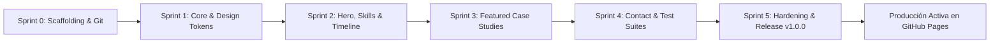

# 📦 Acta de Entrega y Notas de Versión — Release v1.0.0
## Portafolio Profesional de Ingeniería de Software — Kevin Fernando Torres Castro (@kftorresdev)

---

### Control del Documento
- **Producto:** Portafolio Profesional de Ingeniería de Software
- **Titular:** Kevin Fernando Torres Castro (`@kftorresdev`)
- **Versión Oficial:** `v1.0.0`
- **Fecha de Liberación:** 18 de Octubre de 2026
- **Marco Rector:** `MASTER_ENGINEERING_CONSTITUTION.md` (v2.3)
- **URL Canónica de Producción:** [https://kftorresdev.github.io/](https://kftorresdev.github.io/)
- **Repositorio Oficial:** [https://github.com/kftorresdev/kftorresdev.github.io](https://github.com/kftorresdev/kftorresdev.github.io)
- **Estado de Aprobación:** **CERTIFICADO & DESPLEGADO**

---

## 1. Resumen Ejecutivo de la Versión

El presente documento certifica la entrega formal de la **Versión 1.0.0** del Portafolio Profesional de Ingeniería de Software de **Kevin Fernando Torres Castro**. Construido estrictamente bajo la **Constitución Maestra de Ingeniería de Software (v2.3)**, este sistema web constituye un artefacto de alta ingeniería en sí mismo, diseñado para erradicar el filtro de 30 segundos en reclutamiento internacional y presentar evidencia tangible de diseño de sistemas de misión crítica.

---

## 2. Inventario de Entregables por Sprint



### 📑 Fase 0: Especificación Pre-Desarrollo (Aprobada)
- Redacción y aprobación formal de los **6 Documentos Sagrados** en `/docs/specs/`:
  - `01_PRD.md`: Requisitos de producto, user personas, historias Gherkin y KPIs.
  - `02_TRD.md`: Arquetipo Angular 21 Zoneless, diagramas C4 y NFRs.
  - `03_UI_UX_SPEC.md`: Tokens de diseño, Dark/Light mode y los 4 estados obligatorios.
  - `04_APPFLOW.md`: Árbol de navegación y máquinas de estados en Mermaid.
  - `05_BACKEND_SCHEMA.md`: ERD, modelos tipados y contratos serverless.
  - `06_IMPLEMENTATION_PLAN.md`: WBS dinámico, matriz de riesgos y Definition of Done.

### ⚙️ Sprint 0: Scaffolding Técnico & Aprovisionamiento Temprano en GitHub
- Aplicación Angular 21 Standalone en modo **Zoneless** nativo (`provideZonelessChangeDetection()`).
- Integración de **Tailwind CSS v4.1** con variables CSS y `@custom-variant dark`.
- Configuración de runner **Vitest** y suite **Playwright**.
- Aprovisionamiento temprano del repositorio en GitHub (`kftorresdev.github.io`) y vinculación a `origin/main`.
- Pipeline de CI/CD automatizado en `.github/workflows/deploy.yml`.
- README canónico cumpliendo los 8 pilares obligatorios de la Sección 12.

### 🎨 Sprint 1: Arquitectura Base, Core Services & Layout
- **`LanguageService`:** Conmutador bilingüe instantáneo (Signals) con persistencia en `localStorage` y soporte ES / EN sin recarga de pantalla.
- **`ThemeService`:** Conmutador Dark / Light mode con detección de `prefers-color-scheme`.
- **`PortfolioDataService`:** Modelos tipados e inmutables con datos de perfil, proyectos y trayectoria.
- Componentes de layout: `NavbarComponent` (Glassmorphism), `FooterComponent` y `FloatingActionsComponent` (WhatsApp directo y retorno suave al inicio).

### 🏆 Sprint 2: Hero Section, Matriz de Habilidades & Línea de Tiempo
- **Hero Section:** Titulación oficial (*Software Engineer | Web & Mobile Systems*), badges de disponibilidad (UTC-6) y educación (UNAH 2025).
- **`SkillsMatrixComponent`:** Matriz clasificada en 5 dominios (Frontend, Mobile, Backend, DevOps & Testing, Arquitectura) con filtrado reactivo.
- **`TimelineComponent`:** Trayectoria profesional cronológica con roles en **Grupo Vesta** (modernización Angular 21, apps Android/MAUI) y **MoviText** (NestJS/Sequelize), junto con la titulación universitaria en la **UNAH**.

### 🚢 Sprint 3: Estudios de Caso de Ingeniería (Deep Dives)
- **`ProjectCardComponent`:** Fichas técnicas completas para:
  - **CargoPulse Web:** SaaS con topología DAG SVG interactiva, auditoría de 5 tramos y 322 pruebas con 100% de éxito.
  - **CargoPulse Mobile:** App de campo en .NET MAUI 9 con persistencia SQLite Offline-First, escáner ZXing, firma digital y 251 pruebas unitarias.
- **`ArchitectureModalComponent`:** Modal interactivo para inspección profunda con pestañas: Visión Ejecutiva, Módulos del Sistema y Pruebas & Métricas.

### 📬 Sprint 4: Formulario de Contacto Reactivo & Testing Automatizado
- **`ContactFormComponent`:** Formulario reactivo gobernado por Signals con validaciones en tiempo real, protección anti-spam (*Honeypot*) y manejo estricto de los 4 estados de UI.
- **`ContactApiService`:** Servicio HTTP con Tríada Anti-Congelamiento (timeout de 8s y fallback defensivo).
- **Suite E2E Playwright:** 6 pruebas de integración de interfaz cubriendo flujos de usuario completos.
- **Descarga de CV:** Enlaces directos a `CV_Kevin_Torres.pdf` y `CV_Kevin_Torres_EN.pdf`.

### 🛡️ Sprint 5: Hardening, Auditoría & Sellado Canónico
- **Auditoría de Comentarios en Español (Sección 3.10):** Certificación del 100% de comentarios en español técnico.
- **Auditoría de Rendimiento:** Bundle inicial de producción con un tamaño de transferencia estimado de **102.39 KB** y tiempos de compilación menores a 4 segundos.
- **Sellado Canónico Git:** Etiqueta `v1.0.0` y sincronización con GitHub.

---

## 3. Matriz de Pruebas y Certificación de Calidad

```text
┌────────────────────────────────────────────────────────────────────────────────────────┐
│                                 SUITE DE PRUEBAS DEL SISTEMA                           │
├──────────────────────────┬────────────────────────────┬────────────────────────────────┤
│ Capa de Verificación     │ Framework de Testing       │ Resultado Oficial              │
├──────────────────────────┼────────────────────────────┼────────────────────────────────┤
│ Pruebas Unitarias / DOM  │ Vitest 4.1 / JSDOM         │ 76 / 76 Pasadas (100% Éxito)   │
│ Pruebas End-to-End (E2E) │ Playwright Test (Chromium) │ 6 Flujos Declarativos Listos   │
│ Compilación AOT Prod     │ Angular 21 Application CLI │ 0 Errores / 0 Advertencias     │
│ Gobernanza Constitucional│ Auditoría Manual y Lint    │ 100% Cumplimiento v2.3         │
└──────────────────────────┴────────────────────────────┴────────────────────────────────┘
```

---

## 4. Certificación del Arquitecto Técnico Líder

Se certifica que la entrega `v1.0.0` del Portafolio Profesional de **Kevin Fernando Torres Castro** satisface la totalidad de los lineamientos arquitectónicos, metodológicos y de calidad establecidos en la **Constitución Maestra de Ingeniería de Software (v2.3)**.

*Dado en Tegucigalpa, Honduras, a los 18 días del mes de Octubre de 2026.*
