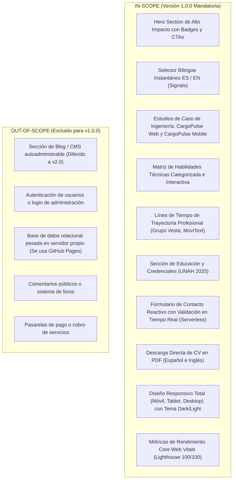

# 01_PRD — Product Requirements Document (Documento de Requisitos de Producto)
## Portafolio Profesional de Ingeniería de Software — Kevin Fernando Torres Castro (@kftorresdev)

---

### Control del Documento
- **Proyecto:** Portafolio Profesional de Ingeniería de Software
- **Titular:** Kevin Fernando Torres Castro (`@kftorresdev`)
- **Versión:** 1.0.0
- **Fase:** Fase 0 (Pre-Desarrollo y Especificación)
- **Marco Rector:** `MASTER_ENGINEERING_CONSTITUTION.md` (v2.3)
- **Estado:** Pendiente de Aprobación Formal

---

## 1. Problema de Negocio y Visión General

### 1.1 El Problema del Mercado
Los reclutadores técnicos, directores de ingeniería (*VP of Engineering*, *Engineering Managers*) y clientes internacionales revisan cientos de currículums y portafolios a la semana. En el ecosistema actual de desarrollo de software:
1. **Falta de Evidencia Tangible de Arquitectura:** La mayoría de los portafolios se limitan a proyectos de juguete ("To-Do lists", clones superficiales o páginas estáticas básicas) que no demuestran competencia en arquitectura de sistemas, manejo de concurrencia, resiliencia ni pruebas automatizadas.
2. **Subestimación del Perfil Profesional:** Ingenieros con sólida formación en ciencias de la computación y experiencia en aplicaciones de misión crítica suelen encasillarse bajo títulos restrictivos (ej. "maquetador web"), perdiendo oportunidades de trabajo remoto senior en dólares (USD).
3. **Fricción de Evaluación y Desconexión:** Los evaluadores disponen de un promedio de **30 a 60 segundos** para tomar una decisión preliminar. Si el portafolio tarda más de 2 segundos en cargar, carece de enlaces directos a demos y repositorios limpios, o no ofrece métricas cuantificables de impacto, el candidato es descartado.
4. **Barrera de Idioma para Contratación Global:** Los perfiles monolingües pierden tracción inmediata frente a vacantes remotas en Estados Unidos y Europa que requieren verificación de comunicación técnica bilingüe en inglés.

### 1.2 La Solución de Producto
Construir una **Plataforma Web de Portafolio de Ingeniería de Software de Alto Rendimiento** que sirva como la carta de presentación canónica de **Kevin Fernando Torres Castro**.  
El portafolio no es una simple galería visual: es un **artefacto de software de producción** en sí mismo, desarrollado bajo estándares de ingeniería de misión crítica (Angular 21 Zoneless, Signals, Tailwind CSS, Clean Architecture en 3 Capas, pruebas E2E con Playwright y 100% bilingüe), demostrando en tiempo real la maestría técnica del autor.

---

## 2. Público Objetivo y User Personas

| Perfil | Rol Típico | Necesidad Operativa / Pain Point | Comportamiento en el Sitio |
| :--- | :--- | :--- | :--- |
| **Persona 1: Tech Recruiter Internacional** | Technical Sourcer / IT Recruiter (EE. UU. / LatAm) | Requiere validar en < 30s habilidades clave (Angular, TypeScript, .NET MAUI, NestJS), nivel de inglés y disponibilidad horaria. | Escanea el Hero, revisa los badges de tecnologías, descarga el CV en PDF (EN) y busca el contacto directo por WhatsApp/LinkedIn. |
| **Persona 2: Engineering Manager / Tech Lead** | Líder Técnico / Director de Arquitectura | Requiere comprobar si el candidato sabe estructurar código limpio, aplicar Clean Architecture, escribir pruebas automatizadas y resolver problemas reales de negocio. | Analiza los casos de estudio (CargoPulse Web & Mobile), examina los diagramas de arquitectura, inspecciona los enlaces a GitHub y revisa la cobertura de pruebas. |
| **Persona 3: Cliente Empresarial / Consultoría** | Founder / COO de empresa logística o startup | Requiere soluciones robustas para digitalizar operaciones de campo o modernizar plataformas legadas. | Lee los problemas resueltos en logística (auditoría de fletes, escáner offline), evalúa la confiabilidad y envía un mensaje mediante el formulario de contacto. |

---

## 3. Alcance Funcional (In-Scope vs Out-of-Scope)



---

## 4. Historias de Usuario Formales (Criterios de Aceptación Gherkin)

### US-01: Visualización Inmediata de Perfil y Propuesta de Valor (Hero Section)
- **Como** evaluador técnico o reclutador,
- **Quiero** acceder a la página principal y comprender de inmediato el perfil profesional, especialidad técnica, ubicación y disponibilidad de Kevin Torres,
- **Para** saber si cumple con los requisitos del perfil que busco en menos de 10 segundos.

```gherkin
Escenario: Carga exitosa del Hero Section
  Dado que el usuario navega a la URL raíz "https://kftorresdev.github.io/"
  Cuando la aplicación se renderiza en el navegador
  Entonces el titular "Kevin Fernando Torres Castro" y el headline "Software Engineer | Web & Mobile Systems" deben ser visibles inmediatamente
  Y se deben mostrar los badges de disponibilidad ("Disponible para trabajo remoto UTC-6"), educación ("Ingeniero en Sistemas - UNAH") y los botones de acción ("Explorar Proyectos", "Descargar CV", "Contactar")
  Y el tiempo de carga del primer contenido visible (FCP) debe ser menor a 0.8 segundos.
```

---

### US-02: Conmutación Bilingüe Instantánea (ES / EN)
- **Como** reclutador internacional de habla inglesa,
- **Quiero** alternar el idioma de todo el portafolio a inglés con un solo clic,
- **Para** evaluar el perfil profesional en mi lengua nativa sin recargar la página.

```gherkin
Escenario: Cambio de idioma sin recarga de página
  Dado que el usuario se encuentra en la versión en español del portafolio
  Cuando presiona el botón selector de idioma "EN" en la barra de navegación
  Entonces todos los textos visibles (Hero, descripción de proyectos, habilidades, experiencia, etiquetas del formulario y footer) se actualizan instantáneamente al inglés
  Y no se debe ejecutar ninguna recarga de página del navegador (cero flashes blancos)
  Y la preferencia de idioma seleccionada se debe persistir en el almacenamiento local ("localStorage") para futuras visitas.
```

---

### US-03: Inspección Técnica de Estudios de Caso (CargoPulse Web & Mobile)
- **Como** líder técnico o evaluador senior,
- **Quiero** inspeccionar los detalles arquitectónicos, problemas resueltos, métricas de calidad y tecnologías aplicadas en CargoPulse Web y CargoPulse Mobile,
- **Para** verificar que el candidato posee criterio de diseño de sistemas de misión crítica.

```gherkin
Escenario: Exploración del caso de estudio de CargoPulse Web
  Dado que el usuario se desplaza a la sección de proyectos destacados
  Cuando visualiza la tarjeta de "CargoPulse Web"
  Entonces debe observar la síntesis ejecutiva del dolor de negocio (ceguera topológica y fuga de fletes), el stack tecnológico (Angular 21 Zoneless, NestJS 12, Prisma, PostgreSQL), las métricas (322 tests, 100% pass) y los enlaces directos a la Demo en Vivo y al Repositorio en GitHub
  Y al hacer clic en "Ver Detalles de Arquitectura", debe desplegarse la vista interactiva con el diagrama C4 y el desglose de los 4 módulos funcionales.

Escenario: Exploración del caso de estudio de CargoPulse Mobile
  Dado que el usuario visualiza la tarjeta de "CargoPulse Mobile"
  Cuando examina sus especificaciones
  Entonces debe observar la resolución de entornos industriales hostiles, el uso de .NET MAUI 9, la persistencia SQLite Offline-First, el escáner ZXing, la firma digital y las 251 pruebas unitarias en ~410 ms
  Y debe contar con un enlace directo al repositorio oficial en GitHub.
```

---

### US-04: Exploración Interactiva de la Matriz de Habilidades
- **Como** reclutador técnico,
- **Quiero** filtrar las habilidades técnicas por dominio (Frontend, Mobile, Backend, DevOps/Testing, Arquitectura),
- **Para** evaluar rápidamente la compatibilidad con el stack requerido por mi empresa.

```gherkin
Escenario: Filtrado de habilidades por categoría
  Dado que el usuario está en la sección "Habilidades Técnicas"
  Cuando hace clic en el filtro "Mobile"
  Entonces la cuadrícula debe resaltar u organizar las competencias específicas (.NET MAUI 9, Android Nativo, SQLite Offline-First, MVVM, ZXing)
  Y las categorías no seleccionadas se atenúan suavemente mediante transiciones CSS sin saltos de interfaz.
```

---

### US-05: Descarga Directa de Currículum Vitae (PDF)
- **Como** reclutador,
- **Quiero** descargar el CV oficial de Kevin Torres en formato PDF en el idioma de mi preferencia,
- **Para** compartirlo internamente con el comité de contratación o adjuntarlo al sistema ATS.

```gherkin
Escenario: Descarga de CV según el idioma activo
  Dado que el usuario tiene seleccionado el idioma español ("ES")
  Cuando pulsa el botón "Descargar CV (PDF)"
  Entonces el navegador debe iniciar la descarga del archivo canónico "CV_Kevin_Torres.pdf"
  Y si el usuario tiene seleccionado el idioma inglés ("EN"), debe descargarse "CV_Kevin_Torres_EN.pdf".
```

---

### US-06: Envío de Mensaje mediante Formulario de Contacto Serverless
- **Como** potencial empleador o cliente,
- **Quiero** enviar un mensaje formal directamente desde la página mediante un formulario reactivo con validaciones en tiempo real,
- **Para** contactar a Kevin sin tener que abrir una aplicación de correo externa obligatoriamente.

```gherkin
Escenario: Validación reactiva de campos obligatorios
  Dado que el usuario deja los campos de nombre o correo vacíos o ingresa un formato de correo inválido
  Cuando interactúa con el formulario
  Entonces los campos deben mostrar mensajes de error contextuales en español o inglés y el botón de envío debe permanecer deshabilitado.

Escenario: Envío exitoso de mensaje
  Dado que el usuario completa su nombre, correo, asunto y mensaje válido
  Cuando presiona el botón "Enviar Mensaje"
  Entonces el botón muestra un estado de carga ("Enviando..."), se envía el payload al servicio serverless
  Y tras la confirmación, se muestra un mensaje de éxito ("¡Mensaje recibido! Te responderé en breve.") y los campos se restablecen limpiamente.
```

---

## 5. Métricas de Éxito y KPIs Cuantitativos

Para garantizar que el portafolio cumpla con el estándar de excelencia de la Constitución de Ingeniería:

| Métrica / KPI | Objetivo / Umbral | Método de Medición |
| :--- | :--- | :--- |
| **Google Lighthouse Performance** | **$\ge 98 / 100$** | Auditoría automatizada de Chrome Lighthouse en modo Mobile y Desktop |
| **Google Lighthouse Accessibility** | **$100 / 100$** | Cumplimiento estricto de contraste WCAG 2.1 AA y atributos ARIA |
| **Google Lighthouse Best Practices** | **$100 / 100$** | Políticas de seguridad, imágenes optimizadas, dependencias limpias |
| **Google Lighthouse SEO** | **$100 / 100$** | Metadatos OpenGraph, etiquetas canónicas, Twitter Cards y semántica HTML5 |
| **Largest Contentful Paint (LCP)** | **$\le 1.0\text{ s}$** | Core Web Vitals en conexiones 4G estándar |
| **Cumulative Layout Shift (CLS)** | **$= 0.00$** | Cero desplazamiento inesperado de elementos durante la carga |
| **First Input Delay / INP** | **$\le 50\text{ ms}$** | Detección reactiva instantánea sin bloqueo del hilo principal |
| **Tiempo de Cambio de Idioma** | **$< 16\text{ ms}$ (1 frame)** | Actualización reactiva mediante Angular Signals sin repintado global |
| **Tasa de Aprobación de Pruebas** | **$100\%$** | Suites unitarias en Vitest y pruebas E2E en Playwright sin tolerar fallos |

---

## 6. Supuestos y Dependencias de Producto
1. **Alojamiento Estático:** El despliegue de producción se ejecutará de forma gratuita, estable y de alta disponibilidad en **GitHub Pages** bajo el dominio canónico `https://kftorresdev.github.io/`.
2. **Servicio Serverless de Mensajería:** Se utilizará un endpoint seguro de Formspree/EmailJS con cuota gratuita suficiente para recepción de oportunidades laborales, sin requerir un servidor backend propio activo las 24 horas.
3. **Persistencia de Preferencias:** El idioma seleccionado (ES/EN) y el tema visual (Dark/Light) se almacenarán en el `localStorage` del cliente para mantener consistencia en visitas recurrentes.

---
*Fin del Documento 01_PRD.md — Pendiente de Aprobación Formal.*
