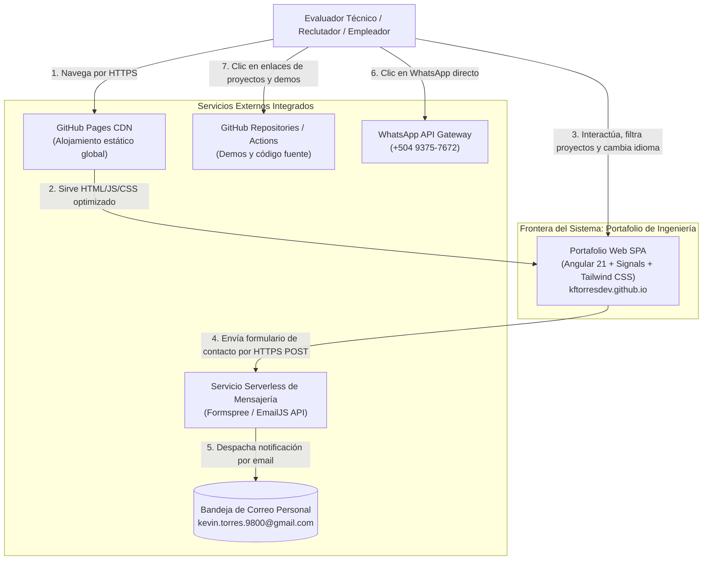
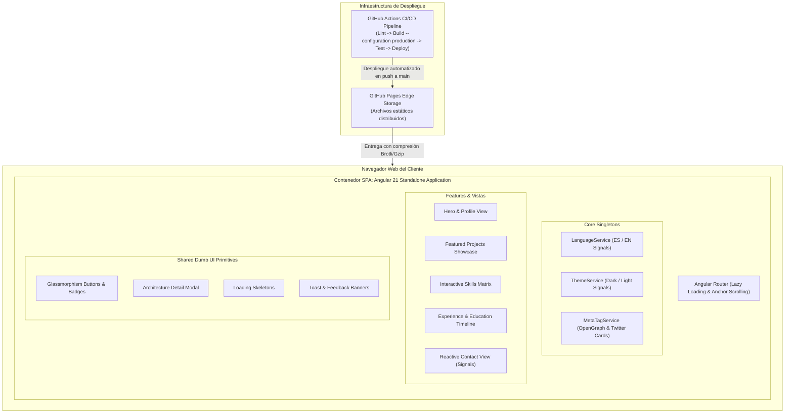

# 02_TRD — Technical Requirements Document (Documento de Requisitos Técnicos)
## Portafolio Profesional de Ingeniería de Software — Kevin Fernando Torres Castro (@kftorresdev)

---

### Control del Documento
- **Proyecto:** Portafolio Profesional de Ingeniería de Software
- **Titular:** Kevin Fernando Torres Castro (`@kftorresdev`)
- **Versión:** 1.0.0
- **Fase:** Fase 0 (Pre-Desarrollo y Especificación)
- **Marco Rector:** `MASTER_ENGINEERING_CONSTITUTION.md` (v2.3)
- **Estado:** Pendiente de Aprobación Formal

---

## 1. Casilla de Arquetipo Técnico (Decisión Constitucional Obligatoria)

En estricta conformidad con la Sección 1.2 de la Constitución de Ingeniería:

- [ ] `Móvil Nativo (Android Studio / Kotlin + Jetpack Compose + NestJS)`
- [ ] `Móvil Multiplataforma (.NET MAUI / C# + NestJS)`
- [ ] `Multi-Cliente (Web Angular + Móvil Nativo/MAUI + NestJS compartido)`
- [X] **`Web SPA de Alto Rendimiento (Angular 21+ Standalone + Zoneless + Signals + Tailwind CSS v4)`**  
  *Alojamiento de Producción: GitHub Pages (`kftorresdev.github.io`) con Entrega Estática Optimizada, Servicio Serverless de Contacto y Automatización con GitHub Actions.*

---

## 2. Topología del Repositorio y Arquitectura del Sistema

### 2.1 Topología del Repositorio
- **Nombre Canónico del Repositorio:** `kftorresdev.github.io`
- **Naturaleza:** Repositorio Web SPA dedicado de alto rendimiento (Monorepo de cliente desacoplado).
- **Entorno de Despliegue:** GitHub Pages en dominio raíz (`https://kftorresdev.github.io/`), lo que garantiza latencia mínima global a través de la red perimetral (CDN) de GitHub.
- **Ruta Base de Compilación:** `--base-href /` (raíz absoluta, sin subdirectorios que rompan rutas).

### 2.2 Arquitectura en 3 Capas (Regla Constitucional 3.2)
Toda interacción de datos en la aplicación transita rígidamente por tres capas:

```mermaid
flowchart TD
    subgraph Layer1 ["Capa 1: Presentación UI (Los Ojos y las Manos)"]
        Components["Componentes Standalone (OnPush)\n• Navbar & Hero\n• ProjectCard & Metrics\n• SkillsMatrix & Timeline\n• ContactForm & Footer"]
    end

    subgraph Layer2 ["Capa 2: Store Reactivo / Signals (El Cerebro)"]
        LangStore["LanguageStore / Service\n(signal, computed, localStorage)"]
        ThemeStore["ThemeStore / Service\n(signal, dark/light persistence)"]
        ProjectsStore["ProjectsStore\n(signal, filters, active modal)"]
        ContactStore["ContactStore\n(FormState signal, loading, error, success)"]
    end

    subgraph Layer3 ["Capa 3: Servicios de Datos & Mensajería (El Mensajero)"]
        DataService["PortfolioDataService\n(Tipado inmutable TypeScript)"]
        ContactApiService["ContactApiService\n(HttpClient POST hacia Formspree / EmailJS)"]
    end

    Layer1 -->|Eventos de usuario / Inyección inject()| Layer2
    Layer2 -->|Lectura reactiva / Signals derivados| Layer1
    Layer2 -->|Peticiones tipadas| Layer3
    Layer3 -->|Datos tipados / DTOs inmutables| Layer2
```

1. **Capa 1: UI / Componentes Standalone:**
   - Componentes puros con `ChangeDetectionStrategy.OnPush`.
   - Cero lógica de negocio, cero transformaciones matemáticas complejas ni peticiones HTTP directas en plantillas.
   - Proyección de estado reactivo mediante signals (`store.currentLanguage()`, `store.projects()`).
2. **Capa 2: Store / Signals (Gestión de Estado):**
   - Estado centralizado y reactivo utilizando `signal()`, `computed()` y `effect()`.
   - Modos de visualización, filtros de categorías de habilidades, estado del formulario (`IDLE`, `SUBMITTING`, `SUCCESS`, `ERROR`).
3. **Capa 3: Servicios de Acceso a Datos (Data Layer):**
   - `PortfolioDataService`: Proveedor centralizado de datos inmutables y tipados con esquemas TypeScript estrictos.
   - `ContactApiService`: Cliente HTTP tipado con interceptor de errores, gestión de cabeceras y control estricto de timeouts.

---

## 3. Diagrama de Arquitectura de Alto Nivel (Modelo C4)

### 3.1 Nivel 1: Diagrama de Contexto del Sistema (System Context)



### 3.2 Nivel 2: Diagrama de Contenedores (Container Diagram)



---

## 4. Stack Tecnológico Detallado

| Componente | Tecnología | Versión | Justificación Técnica |
| :--- | :--- | :--- | :--- |
| **Framework Web** | Angular | `^21.0.0` | Arquitectura Standalone nativa, rendimiento extremo sin `zone.js`, reactividad fina con Signals y sintaxis moderna de control flow (`@if`, `@for`). |
| **Lenguaje de Programación** | TypeScript | `^5.7.0` | Tipado estricto (`"strict": true`), interfaces inmutables, cero uso de `any` (*Zero Any Policy*). |
| **Motor de Estilos & Diseño** | Tailwind CSS | `^4.0.0` | Configuración modular de tokens de diseño, cero CSS muerto en producción, variables CSS nativas para soporte instantáneo de Dark/Light mode. |
| **Detección de Cambios** | Zoneless Nativo | Angular 21 | Habilitado mediante `provideExperimentalZonelessChangeDetection()`, eliminando los microparches de `zone.js` y reduciendo el tamaño del bundle en ~35 KB. |
| **Iconografía** | Lucide Icons / SVG Nativos | Optimizado | Cero fuentes de iconos pesadas; únicamente SVGs vectoriales inline o componentes SVG optimizados para carga instantánea. |
| **Pruebas Unitarias** | Vitest | `^2.1.0` | Ejecución ultrarrápida de pruebas de servicios, Signals derivados y validaciones de formularios en milisegundos. |
| **Pruebas End-to-End (E2E)** | Playwright | `^1.49.0` | Validación exhaustiva de flujos de usuario (Hero, conmutador de idioma ES/EN, modal de proyectos, formulario de contacto) sobre navegadores reales Chromium. |
| **Integración Continua / CD** | GitHub Actions | v4 | Pipeline declarativo en `.github/workflows/deploy.yml` que valida linters, compila, corre pruebas y publica a GitHub Pages. |
| **Mapeo de Rutas SPA en GitHub Pages** | Script `404.html` Trick | Estandarizado | Redirección sin pérdidas de rutas SPA en servidores estáticos que no soportan reescritura nativa de URL. |

---

## 5. Requerimientos No Funcionales (NFRs)

### 5.1 Rendimiento y Latencia (Performance SLA)
- **Time to First Byte (TTFB):** $< 150\text{ ms}$ servido desde la CDN de GitHub Pages.
- **First Contentful Paint (FCP):** $< 0.8\text{ s}$ en conexiones 4G móviles.
- **Largest Contentful Paint (LCP):** $< 1.2\text{ s}$.
- **Cumulative Layout Shift (CLS):** Exactamente $0.00$ (reserva explícita de dimensiones para imágenes y contenedores).
- **Bundle Size Inicial:** Menor a $180\text{ KB}$ (gzipped / brotli), garantizado mediante code splitting y exclusión de dependencias no esenciales.

### 5.2 Seguridad (Security & OWASP)
- **Cero Secretos en el Repositorio:** Prohibido quemar API keys privadas en el código fuente. Las variables públicas de contacto (ID de servicio Formspree) se manejarán mediante `environment.ts`.
- **Content Security Policy (CSP):** Encabezados restrictivos que prohíben la ejecución de scripts no confiables o ataques XSS en formularios.
- **Sanitización de Entradas:** Validación y sanitización estricta de todos los campos del formulario de contacto antes de enviarlos al servicio externo.
- **Protección contra Spam:** Inclusión de un campo señuelo oculto (*Honeypot field*) en el formulario para neutralizar bots de spam sin degradar la experiencia del usuario con CAPTCHAs invasivos.

### 5.3 Accesibilidad (WCAG 2.1 AA)
- Ratio de contraste mínimo de **4.5:1** para texto normal y **3:1** para texto grande en ambos temas (Dark y Light).
- Navegación completa por teclado con indicadores de foco (`focus-visible`) nítidos y accesibles.
- Etiquetas semánticas HTML5 (`<header>`, `<nav>`, `<main>`, `<section>`, `<article>`, `<footer>`) y atributos `aria-label`, `aria-expanded` y `aria-live` para lectores de pantalla.

### 5.4 Optimización para Motores de Búsqueda (SEO) y Redes Sociales
- Metadatos canónicos dinámicos mediante `Title` y `Meta` de Angular.
- Soporte completo de **OpenGraph** (`og:title`, `og:description`, `og:image`, `og:url`) y **Twitter Cards** para que al compartir el enlace del portafolio en LinkedIn, Twitter o WhatsApp se genere una vista previa visualmente impactante.
- Archivos estándar `robots.txt` y `sitemap.xml` generados automáticamente en el directorio de salida.

---

## 6. Pipeline de CI/CD y Estrategia de Despliegue

```mermaid
flowchart LR
    A["git push origin main"] --> B["GitHub Actions Runner"]
    subgraph Pipeline ["Pipeline de Calidad y Despliegue (.github/workflows/deploy.yml)"]
        C["1. Checkout & Setup Node.js 22"]
        D["2. npm ci (Instalación Limpia)"]
        E["3. npm run lint (Verificación de Estilo)"]
        F["4. npm run test:unit (Vitest)"]
        G["5. npm run build --configuration production"]
        H["6. Deploy to GitHub Pages (actions/deploy-pages@v4)"]
    end
    B --> C
    C --> D
    D --> E
    E --> F
    F --> G
    G --> H
    H --> I["Producción Activa en https://kftorresdev.github.io/"]
```



- **Branch Protection:** La rama `main` es sagrada. Ningún código se despliega sin pasar previamente el pipeline de validación y compilación limpia.
- **Conventional Commits:** Todo cambio debe seguir la convención semántica (`feat:`, `fix:`, `docs:`, `style:`, `refactor:`, `test:`, `chore:`).

---
*Fin del Documento 02_TRD.md — Pendiente de Aprobación Formal.*
