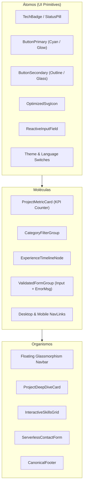
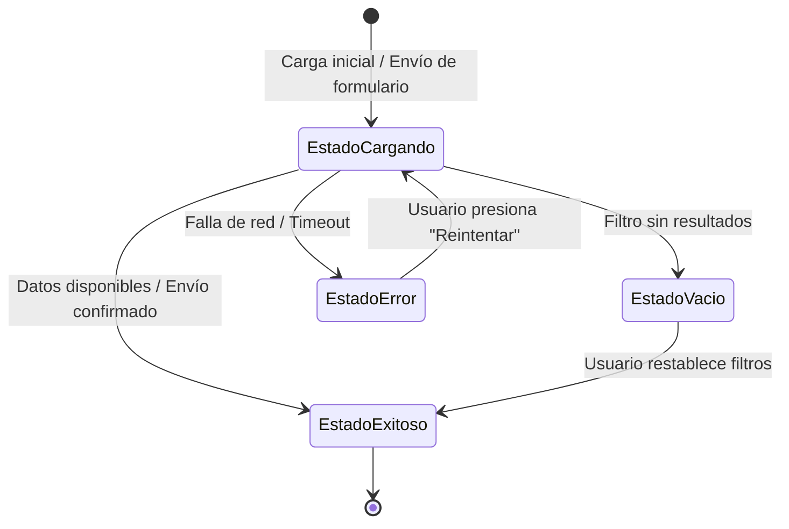

# 03_UI_UX_SPEC — UI/UX Design Specification & Visual System
## Portafolio Profesional de Ingeniería de Software — Kevin Fernando Torres Castro (@kftorresdev)

---

### Control del Documento
- **Proyecto:** Portafolio Profesional de Ingeniería de Software
- **Titular:** Kevin Fernando Torres Castro (`@kftorresdev`)
- **Versión:** 1.0.0
- **Fase:** Fase 0 (Pre-Desarrollo y Especificación)
- **Marco Rector:** `MASTER_ENGINEERING_CONSTITUTION.md` (v2.3)
- **Estado:** Pendiente de Aprobación Formal

---

## 1. Fundamentos de Diseño y Filosofía Visual

El portafolio adopta una estética **"Engineering-Grade / Developer-First"**, inspirada en los estándares de interfaces de vanguardia de la industria tecnológica de alto nivel (como Vercel, Linear, Supabase y GitHub):
1. **Claridad sobre Ornamento:** Cada píxel, badge y botón tiene un propósito funcional. Se evita el abuso de animaciones lentas o efectos recargados que entorpezcan la lectura del perfil por parte de reclutadores.
2. **Jerarquía Visual Inmediata:** Contraste tipográfico nítido para guiar el ojo del evaluador desde el nombre y titulación hacia las métricas duras de los proyectos en los primeros 3 segundos.
3. **Glassmorphism Técnico Sutil:** Fondos oscuros profundos con desenfoque de fondo (*backdrop blur*), bordes milimétricos translúcidos y acentos cromáticos de alta tecnología (Cyan eléctrico, Índigo y Esmeralda).

---

## 2. Sistema de Diseño (Design Tokens)

### 2.1 Paleta Cromática (Color Palette)

El sistema de colores se basa en **Tailwind CSS v4** mediante variables CSS dinámicas que se ajustan automáticamente según el tema activo:

```text
┌────────────────────────────────────────────────────────────────────────────────────────┐
│                                  DESIGN TOKENS: COLORS                                 │
├──────────────────────────┬────────────────────────────┬────────────────────────────────┤
│ Rol Semántico            │ Modo Oscuro (Predeterminado)│ Modo Claro (Alternativo)       │
├──────────────────────────┼────────────────────────────┼────────────────────────────────┤
│ Superficie de Fondo (Base)│ Zinc 950 (`#09090b`)       │ Slate 50 (`#f8fafc`)           │
│ Superficie Secundaria (Card) Zinc 900 (`#18181b`)     │ Blanco Puro (`#ffffff`)        │
│ Superficies Elevadas (Hover) Zinc 800/80 (`#27272a`)  │ Slate 100 (`#f1f5f9`)          │
│ Bordes & Separadores     │ Zinc 800 (`#27272a`)        │ Slate 200 (`#e2e8f0`)          │
│ Texto Principal          │ Zinc 50 (`#fafafa`)         │ Slate 900 (`#0f172a`)          │
│ Texto Secundario/Muted   │ Zinc 400 (`#a1a1aa`)        │ Slate 600 (`#475569`)          │
├──────────────────────────┴────────────────────────────┴────────────────────────────────┤
│ Acentos Tecnológicos Semánticos                                                        │
├──────────────────────────┬────────────────────────────┬────────────────────────────────┤
│ Primario / Acción        │ Cyan 500 (`#06b6d4`)        │ Blue 600 (`#2563eb`)           │
│ Secundario / Destacado   │ Indigo 400 (`#818cf8`)      │ Indigo 600 (`#4f46e5`)         │
│ Éxito / Estado Activo    │ Emerald 400 (`#34d399`)     │ Emerald 600 (`#059669`)        │
│ Alerta / Precaución      │ Amber 400 (`#fbbf24`)       │ Amber 600 (`#d97706`)          │
│ Error / Crítico          │ Rose 400 (`#fb7185`)        │ Rose 600 (`#e11d48`)           │
└──────────────────────────┴────────────────────────────┴────────────────────────────────┘
```

### 2.2 Tipografía (Typography Scale)
- **Fuente Principal de Lectura (Sans):** `Inter`, `-apple-system`, `BlinkMacSystemFont`, `Segoe UI`, `Roboto`, `sans-serif`.  
  *Justificación:* Excelente legibilidad en pantallas de alta densidad y neutralidad tipográfica moderna.
- **Fuente Técnica / Código (Mono):** `JetBrains Mono`, `Fira Code`, `Consolas`, `monospace`.  
  *Justificación:* Utilizada para tags de tecnologías, números de versión, comandos de terminal, métricas y fragmentos de código.

| Nivel Tipográfico | Clase Tailwind | Tamaño / Interlineado | Peso | Uso Principal |
| :--- | :--- | :--- | :--- | :--- |
| **Display Hero** | `text-4xl md:text-6xl` | $36\text{px} - 60\text{px} / 1.1$ | Bold (700/800) | Nombre titular en Hero |
| **H1 Sección** | `text-3xl md:text-4xl` | $30\text{px} - 36\text{px} / 1.2$ | Bold (700) | Títulos de secciones principales |
| **H2 Tarjeta** | `text-xl md:text-2xl` | $20\text{px} - 24\text{px} / 1.3$ | Semi-Bold (600) | Títulos de proyectos y roles |
| **H3 Subtítulo** | `text-lg` | $18\text{px} / 1.4$ | Medium (500) | Subtítulos de módulos y métricas |
| **Body (Cuerpo)** | `text-base` | $16\text{px} / 1.6$ | Regular (400) | Párrafos descriptivos y biografías |
| **Body Small** | `text-sm` | $14\text{px} / 1.5$ | Regular / Medium | Fechas, empresas, notas al pie |
| **Badge / Caption**| `text-xs font-mono` | $12\text{px} / 1.4$ | Medium (500) | Tags de tecnologías y KPIs |

### 2.3 Espaciado, Radios de Borde y Sombras
- **Contenedor Máximo:** `max-w-6xl mx-auto px-4 sm:px-6 lg:px-8`.
- **Radios de Borde (Border Radius):**
  - Botones y Badges: `rounded-lg` ($8\text{px}$) y `rounded-full` para píldoras.
  - Tarjetas y Paneles: `rounded-2xl` ($16\text{px}$).
  - Modales: `rounded-3xl` ($24\text{px}$).
- **Efectos de Elevación (Shadows & Blurs):**
  - Tarjetas inactivas: `border border-zinc-800 bg-zinc-900/60 backdrop-blur-md`.
  - Tarjetas en hover: `border-cyan-500/40 shadow-xl shadow-cyan-500/5 -translate-y-1 transition-all duration-300`.

---

## 3. Inventario de Componentes Atómicos (Design System Catalog)



### 3.1 Barra de Navegación Flotante (`NavbarComponent`)
- **Comportamiento:** Fija en la parte superior con efecto *Glassmorphism* (`backdrop-blur-md bg-zinc-950/80 border-b border-zinc-800/80`).
- **Elementos:**
  - Logotipo / Marca: `</> kftorresdev` con acento en Cyan.
  - Menú de navegación por anclas suaves: `Proyectos`, `Habilidades`, `Experiencia`, `Contacto`.
  - Controles Rápidos:
    - Botón de cambio de idioma: Píldora interactiva `ES | EN` con indicador activo gobernado por Signals.
    - Botón de cambio de tema: Alternador `☀️ / 🌙` con animación suave.
    - Botón CTA directo: `Descargar CV` (abre menú o descarga directa).
  - Menú hamburguesa responsivo para dispositivos móviles con apertura animada sin saltos.

### 3.2 Tarjeta de Estudio de Caso (`ProjectCardComponent`)
- **Cabecera:** Nombre del proyecto, insignia de estado (`v1.0.0`, `Producción`, `Misión Crítica`), breve síntesis del dolor de negocio.
- **Grícula de Métricas de Ingeniería:** 3 a 4 indicadores clave en tarjetas compactas:
  - *CargoPulse Web:* `322 Tests (100%)`, `Angular 21 Zoneless`, `SVG DAG Network`, `Persistencia Dual`.
  - *CargoPulse Mobile:* `251 Tests Unitarios`, `.NET MAUI 9`, `Offline SQLite`, `Zero-ANR < 2s`.
- **Tags de Tecnologías:** Píldoras con tipografía monoespaciada coloreadas por categoría.
- **Barra de Acciones:**
  - Botón principal: `Demo en Vivo` (con icono de lanzamiento externo).
  - Botón secundario: `Ver en GitHub` (con icono oficial de GitHub).
  - Botón terciario: `Arquitectura y Detalles` (despliega modal con diagrama C4 y explicación técnica).

### 3.3 Matriz de Habilidades Interactiva (`SkillsMatrixComponent`)
- **Barra de Filtros:** Botones tipo pestaña: `Todas`, `Frontend`, `Mobile`, `Backend`, `DevOps & Testing`, `Arquitectura`.
- **Tarjetas de Dominio:** Cada tarjeta agrupa las herramientas con indicador visual de experiencia real aplicada en proyectos de producción.

### 3.4 Línea de Tiempo de Trayectoria (`TimelineComponent`)
- Nodos verticales con línea continua conectora.
- Cada elemento incluye: Periodo de fechas en `font-mono`, cargo exacto, empresa destacada con enlace a su sector, viñetas de logros de ingeniería redactadas en formato STAR (*Situación, Tarea, Acción, Resultado*) y tecnologías utilizadas.

### 3.5 Formulario de Contacto Reactivo (`ContactFormComponent`)
- Campos:
  1. `Nombre Completo` (obligatorio, mínimo 3 caracteres).
  2. `Correo Electrónico` (obligatorio, validador de formato RFC 5322).
  3. `Asunto / Motivo` (select con opciones: *Oportunidad Laboral Remota, Consultoría / Proyecto, Pregunta Técnica, Otro*).
  4. `Mensaje` (obligatorio, mínimo 15 caracteres, contador dinámico de caracteres).
  5. Campo señuelo *Honeypot* (oculto vía CSS accesible solo a bots; si viene lleno, el envío se descarta silenciosamente).
- Botón de envío con spinner integrado y estados de retroalimentación claros.

---

## 4. Manejo Obligatorio de los 4 Estados de UI (Regla Constitucional 1.3)

Queda estrictamente prohibido que la interfaz presente pantallas en blanco, bloqueos visuales o mensajes técnicos incomprensibles. Todo componente con carga de datos o interacción asíncrona implementa los siguientes 4 estados:



### 1. Estado Cargando (Loading State)
- **Implementación:** Skeletons animados con gradiente pulsante (`animate-pulse bg-zinc-800/60 rounded-xl`).
- **Regla:** Ningún contenido tarda en mostrar su estructura visual. En el formulario de contacto, el botón cambia a `Enviando mensaje...` con un spinner vectorial SVG y se deshabilitan los inputs para evitar doble envío (*idempotencia*).

### 2. Estado Vacío (Empty State)
- **Implementación:** Si el usuario filtra habilidades por un criterio sin coincidencias o busca un proyecto inexistente:
  - Icono ilustrativo amigable (caja vacía o lupa).
  - Título: *"No se encontraron tecnologías en esta categoría"*.
  - Call to Action (CTA): Botón *"Restablecer todos los filtros"* que restaura la visualización completa con un solo clic.

### 3. Estado Error (Error State)
- **Implementación:** Si el servicio serverless de contacto no responde tras 8 segundos o el cliente no tiene conexión a internet:
  - Banner en tono `Rose-500` con borde suave y texto legible en español e inglés.
  - Mensaje: *"Ocurrió un inconveniente al enviar tu mensaje. Puedes escribirme directamente a kevin.torres.9800@gmail.com o enviarme un WhatsApp"*.
  - Botón *"Reintentar envío"* y botón directo *"Abrir WhatsApp"*.

### 4. Estado Exitoso / Activo (Success State)
- **Implementación:** Al confirmarse el envío del formulario:
  - Banner animado en tono `Emerald-500` con icono de verificación (*Checkmark*).
  - Mensaje: *"¡Mensaje enviado con éxito! Te responderé en menos de 24 horas."*
  - Reseteo limpio de los campos del formulario con preservación de estado consistente.

---

## 5. Adaptabilidad y Breakpoints (Responsive Design)

La aplicación es **100% responsiva** bajo el enfoque *Mobile-First*, respetando las áreas seguras de visualización (*Safe Areas*):

| Breakpoint | Ancho Mínimo | Ajuste de Layout | Comportamiento Navbar & Hero |
| :--- | :--- | :--- | :--- |
| **Mobile (`default`)** | $< 640\text{px}$ | 1 columna vertical | Navbar colapsada en menú flotante; botones de CTA en ancho completo; padding seguro para notches. |
| **Tablet (`sm` / `md`)**| $640\text{px} - 768\text{px}$ | 1 a 2 columnas | Grilla de proyectos en 1 columna amplia; métricas en cuadrícula $2 \times 2$; menú comprimido. |
| **Desktop (`lg`)** | $1024\text{px}$ | 2 columnas en proyectos | Navbar expandida con todos los enlaces directos; modales centrados con backdrop desenfocado. |
| **Ultrawide (`xl` / `2xl`)** | $\ge 1280\text{px}$ | Contenedor acotado | Ancho restringido a `max-w-6xl` con márgenes automáticos para evitar fatiga de lectura ocular. |

---
*Fin del Documento 03_UI_UX_SPEC.md — Pendiente de Aprobación Formal.*
