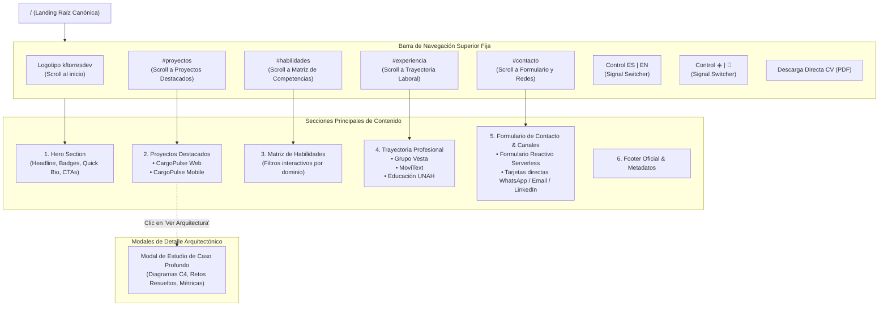
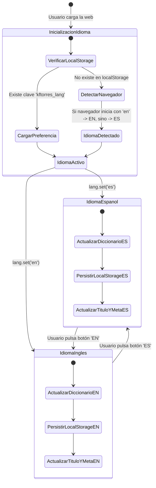
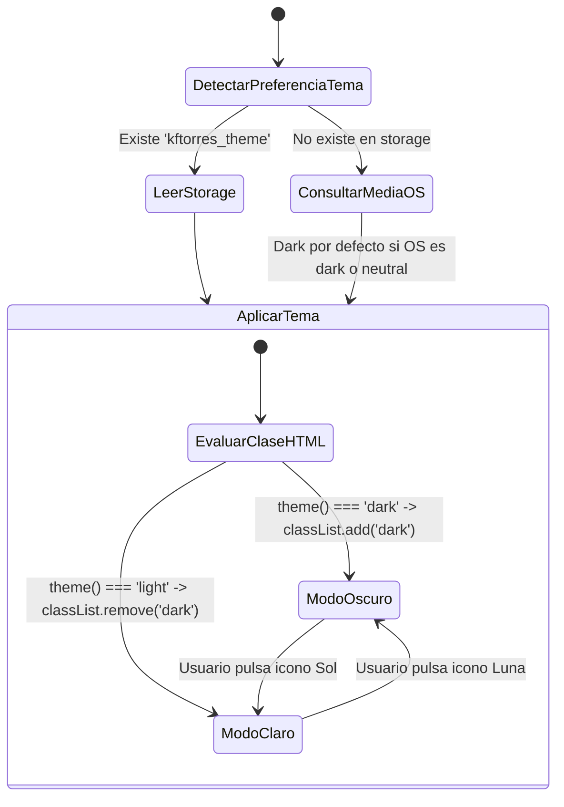
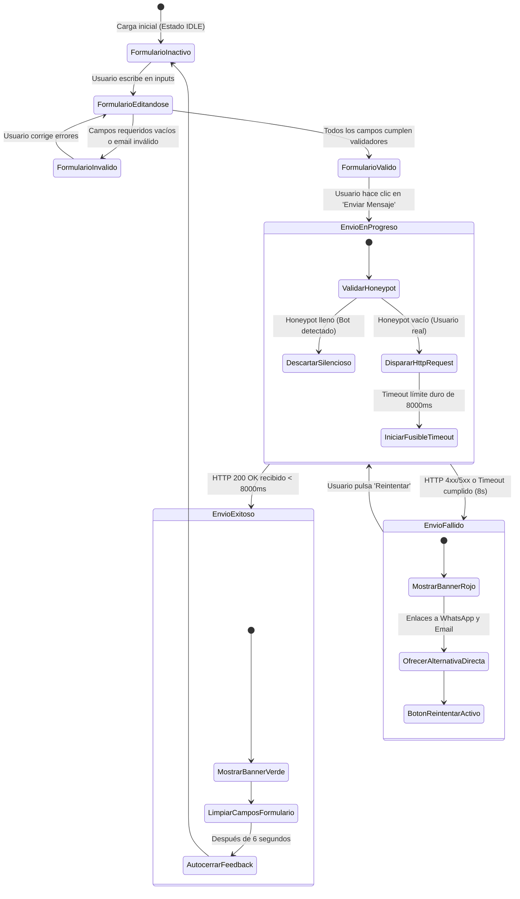
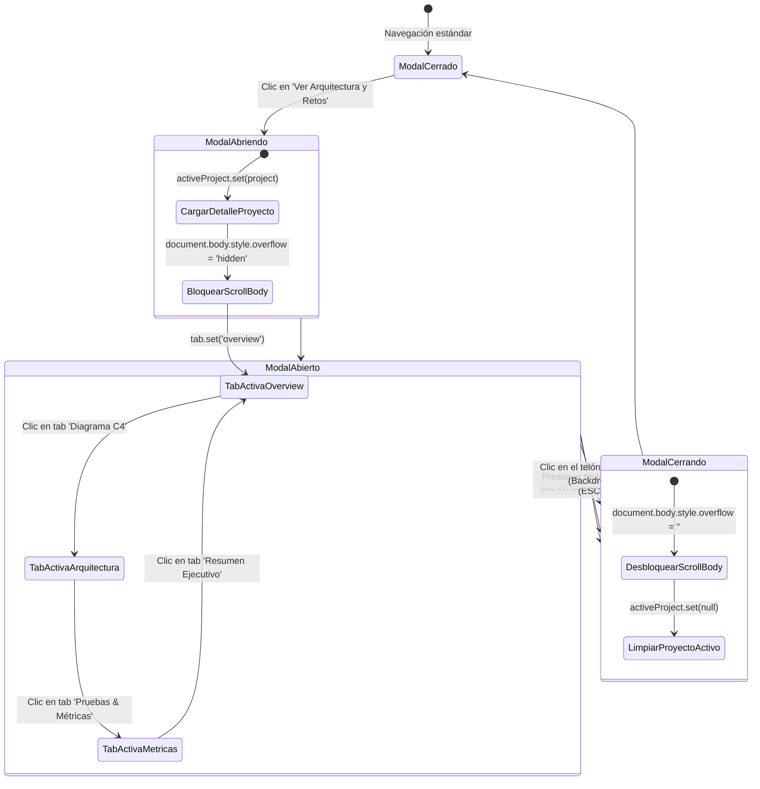

# 04_APPFLOW — Navigation Flows & Application State Machines
## Portafolio Profesional de Ingeniería de Software — Kevin Fernando Torres Castro (@kftorresdev)

---

### Control del Documento
- **Proyecto:** Portafolio Profesional de Ingeniería de Software
- **Titular:** Kevin Fernando Torres Castro (`@kftorresdev`)
- **Versión:** 1.0.0
- **Fase:** Fase 0 (Pre-Desarrollo y Especificación)
- **Marco Rector:** `MASTER_ENGINEERING_CONSTITUTION.md` (v2.3)
- **Estado:** Pendiente de Aprobación Formal

---

## 1. Árbol de Navegación Jerárquico del Sistema

La aplicación está diseñada bajo el patrón de **Single-Page Application (SPA) de Alto Rendimiento** con navegación fluida por anclas contextuales, combinada con sub-enrutamiento para modales de estudio de caso de arquitectura:

---

## 2. Matriz de Control de Acceso por Pantalla y Vistas

Dado que este portafolio es un escaparate profesional público orientado a evaluadores, clientes y reclutadores de todo el mundo:

| Sección / Vista | Nivel de Acceso | Mecanismo de Seguridad | Descripción y Comportamiento |
| :--- | :--- | :--- | :--- |
| **Hero & Perfil** | Público | Acceso Libre | Renderizado instantáneo; sin autenticación requerida. |
| **Proyectos Insignia** | Público | Acceso Libre | Muestra resúmenes, métricas y enlaces directos a repositorios y demos públicas. |
| **Modales de Arquitectura** | Público | Control de Estado (Signal) | Se abre y cierra mediante reactividad local; previene scroll del body de fondo. |
| **Matriz de Habilidades** | Público | Filtrado Reactivo | Interacción fluida en memoria del cliente sin llamadas al servidor. |
| **Trayectoria & Educación**| Público | Acceso Libre | Visualización cronológica ordenada. |
| **Formulario de Contacto** | Público con Protección | Rate-Limiting & Honeypot | Control anti-spam mediante honeypot invisible y debounce en el botón de envío. |
| **Descarga de CV (PDF)** | Público | Enlace Estático Seguro | Descarga directa desde `/assets/docs/` en español o inglés según corresponda. |

---

## 3. Máquinas de Estados de Flujos Críticos

### 3.1 Máquina de Estados: Selector Bilingüe Instantáneo (ES / EN)

El idioma del portafolio se gobierna mediante un Signal reactivo centralizado en `LanguageService`. No requiere recargar el navegador ni consultar APIs externas:

### 3.2 Máquina de Estados: Selector de Tema Visual (Dark / Light)

El tema se gestiona mediante Signals con persistencia en `localStorage` y detección automática de la preferencia del sistema operativo del usuario (`prefers-color-scheme`):

### 3.3 Máquina de Estados: Envío de Formulario de Contacto Reactivo

El flujo de contacto implementa la **Tríada Anti-Congelamiento** de la Constitución (Fusible temporal, guarda de timeout y fallback defensivo):

### 3.4 Máquina de Estados: Modal de Estudio de Caso de Arquitectura

---
*Fin del Documento 04_APPFLOW.md — Pendiente de Aprobación Formal.*
