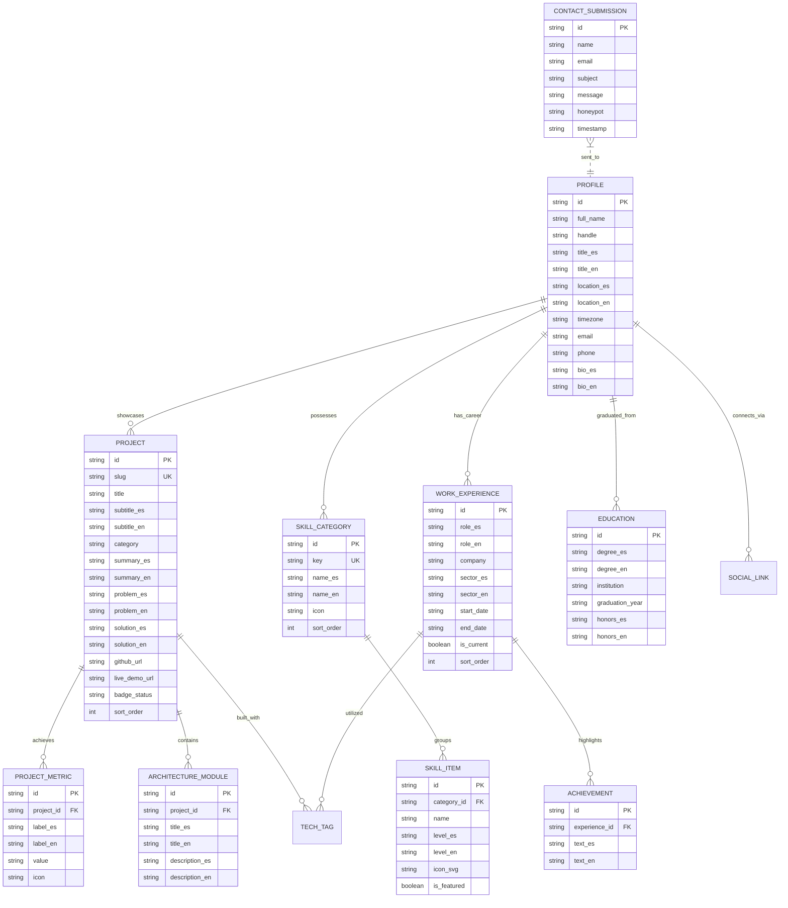

# 05_BACKEND_SCHEMA — Data Models, Architecture & API Contracts
## Portafolio Profesional de Ingeniería de Software — Kevin Fernando Torres Castro (@kftorresdev)

---

### Control del Documento
- **Proyecto:** Portafolio Profesional de Ingeniería de Software
- **Titular:** Kevin Fernando Torres Castro (`@kftorresdev`)
- **Versión:** 1.0.0
- **Fase:** Fase 0 (Pre-Desarrollo y Especificación)
- **Marco Rector:** `MASTER_ENGINEERING_CONSTITUTION.md` (v2.3)
- **Estado:** Pendiente de Aprobación Formal

---

## 1. Arquitectura de Datos y Persistencia

Dado que la aplicación es una **Web SPA alojada en GitHub Pages**, la persistencia de datos adopta una arquitectura desacoplada de alto rendimiento:
1. **Modelos de Datos Inmutables en Cliente:** Todos los datos del portafolio (perfil, proyectos, métricas, habilidades, trayectoria laboral y credenciales) se modelan bajo contratos estrictos de TypeScript (`readonly`) y se suministran a través de la **Capa 3 (`PortfolioDataService`)** hacia la **Capa 2 (Signals Store)**.
2. **Persistencia Local de Preferencias:** El idioma activo (`es` | `en`) y el tema visual (`dark` | `light`) se persisten en el `localStorage` del navegador bajo claves de dominio con nombres seguros (`kftorres_lang`, `kftorres_theme`).
3. **Contrato de API Serverless para Mensajería:** Las peticiones de contacto se serializan hacia un servicio serverless (Formspree / EmailJS) mediante peticiones HTTP `POST` con tipado estricto y respuestas normalizadas.

---

## 2. Diagrama Entidad-Relación (ERD)



---

## 3. Diccionario de Datos & Contratos Tipados de TypeScript (Strict Typings)

En conformidad con la regla de la Constitución de **Comentarios 100% en Español** y **Cero Any**:

```typescript
/**
 * Idiomas admitidos por el sistema bilingüe reactivo.
 */
export type SupportedLanguage = 'es' | 'en';

/**
 * Temas visuales admitidos por el sistema de diseño.
 */
export type ThemeMode = 'dark' | 'light';

/**
 * Categorías funcionales de habilidades técnicas.
 */
export type SkillCategoryKey = 'frontend' | 'mobile' | 'backend' | 'devops_testing' | 'architecture';

/**
 * Información del perfil profesional del autor.
 */
export interface ProfileData {
  readonly id: string;
  readonly fullName: string;
  readonly handle: string;
  readonly title: Record<SupportedLanguage, string>;
  readonly location: Record<SupportedLanguage, string>;
  readonly timezone: string;
  readonly availability: Record<SupportedLanguage, string>;
  readonly email: string;
  readonly phone: string;
  readonly whatsappUrl: string;
  readonly githubUrl: string;
  readonly linkedinUrl: string;
  readonly bioSummary: Record<SupportedLanguage, string>;
  readonly cvDownloadUrls: Record<SupportedLanguage, string>;
}

/**
 * Métrica cuantitativa de calidad o impacto de un proyecto.
 */
export interface ProjectMetric {
  readonly id: string;
  readonly label: Record<SupportedLanguage, string>;
  readonly value: string;
  readonly iconName: string;
}

/**
 * Módulo o subsistema arquitectónico de un proyecto de ingeniería.
 */
export interface ArchitectureModule {
  readonly id: string;
  readonly title: Record<SupportedLanguage, string>;
  readonly description: Record<SupportedLanguage, string>;
}

/**
 * Definición canónica de un estudio de caso de proyecto.
 */
export interface ProjectItem {
  readonly id: string;
  readonly slug: string;
  readonly title: string;
  readonly subtitle: Record<SupportedLanguage, string>;
  readonly category: 'Web SaaS' | 'Mobile Field';
  readonly badgeStatus: string;
  readonly summary: Record<SupportedLanguage, string>;
  readonly businessProblem: Record<SupportedLanguage, string>;
  readonly technicalSolution: Record<SupportedLanguage, string>;
  readonly keyHighlights: Record<SupportedLanguage, readonly string[]>;
  readonly metrics: readonly ProjectMetric[];
  readonly architectureModules: readonly ArchitectureModule[];
  readonly techStack: readonly string[];
  readonly githubUrl: string;
  readonly liveDemoUrl?: string;
  readonly architectureDiagramSvg?: string;
  readonly sortOrder: number;
}

/**
 * Ítem individual de habilidad técnica.
 */
export interface SkillItem {
  readonly id: string;
  readonly name: string;
  readonly level: Record<SupportedLanguage, string>;
  readonly isFeatured: boolean;
  readonly badgeColor: string;
}

/**
 * Grupo clasificado de habilidades técnicas.
 */
export interface SkillCategory {
  readonly id: string;
  readonly key: SkillCategoryKey;
  readonly name: Record<SupportedLanguage, string>;
  readonly iconName: string;
  readonly skills: readonly SkillItem[];
  readonly sortOrder: number;
}

/**
 * Registro de trayectoria profesional en la industria.
 */
export interface WorkExperienceItem {
  readonly id: string;
  readonly role: Record<SupportedLanguage, string>;
  readonly company: string;
  readonly sector: Record<SupportedLanguage, string>;
  readonly period: Record<SupportedLanguage, string>;
  readonly isCurrent: boolean;
  readonly achievements: Record<SupportedLanguage, readonly string[]>;
  readonly technologies: readonly string[];
  readonly sortOrder: number;
}

/**
 * Registro de educación formal y acreditaciones académicas.
 */
export interface EducationItem {
  readonly id: string;
  readonly degree: Record<SupportedLanguage, string>;
  readonly institution: string;
  readonly graduationYear: string;
  readonly status: Record<SupportedLanguage, string>;
}
```

---

## 4. Plan de Datos Semilla y Maestros (`portfolio-data.ts`)

Los datos iniciales inmutables contendrán con absoluta precisión la información contrastada del CV y los repositorios de Kevin Torres:

### 4.1 Datos Maestros del Perfil
- **Nombre:** Kevin Fernando Torres Castro
- **Handle:** `@kftorresdev`
- **Títulos:**
  - `es`: "Ingeniero de Software | Especialista en Sistemas Web y Móviles"
  - `en`: "Software Engineer | Web & Mobile Systems Specialist"
- **Ubicación:** Tegucigalpa, Honduras (UTC-6 / US Central Time Zone)
- **Disponibilidad:**
  - `es`: "Disponible para trabajo remoto global (Tiempo Completo / Contrato USD)"
  - `en`: "Available for global remote work (Full-Time / USD Contract)"

### 4.2 Proyectos Maestros Pre-cargados
1. **CargoPulse Web:**
   - Métricas: `322 Tests (100% Pass)`, `Angular 21 Zoneless`, `Dual Persistence Failover`, `5-Leg Freight Audit`.
   - Tecnologías: `Angular 21`, `NestJS 12`, `TypeScript 5.7+`, `Tailwind CSS v4`, `Prisma ORM`, `PostgreSQL 16`, `Playwright`, `Docker`.
   - Repositorio: `https://github.com/kftorresdev/CargoPulse`
   - Demo en Vivo: `https://kftorresdev.github.io/CargoPulse/`
2. **CargoPulse Mobile:**
   - Métricas: `251 Unit Tests (~410ms)`, `.NET MAUI 9`, `Offline SQLite`, `Zero-ANR Triad (<2s)`.
   - Tecnologías: `.NET MAUI 9`, `C# 13`, `SQLite (sqlite-net-pcl)`, `CommunityToolkit.Mvvm`, `ZXing Barcode/QR`, `Maestro E2E`, `GitHub Actions CI`.
   - Repositorio: `https://github.com/kftorresdev/CargoPulse-mobile`

---

## 5. Contrato de API Serverless para Formulario de Contacto

### 5.1 Endpoint y Método HTTP
- **URL Destino:** `https://formspree.io/f/{FORM_ID}` (configurado de manera segura mediante inyección de ambiente).
- **Método HTTP:** `POST`
- **Cabeceras Obligatorias:**
  - `Content-Type: application/json`
  - `Accept: application/json`

### 5.2 Contrato de Carga Útil (Request Payload DTO)
```typescript
/**
 * DTO para envío de mensaje de contacto.
 */
export interface ContactMessageDto {
  /** Nombre completo del remitente (Mínimo 3 caracteres) */
  name: string;
  /** Correo electrónico válido del remitente */
  email: string;
  /** Motivo del contacto */
  subject: string;
  /** Contenido del mensaje (Mínimo 15 caracteres) */
  message: string;
  /** Campo trampa anti-spam (Debe enviarse vacío) */
  _gotcha?: string;
}
```

### 5.3 Respuestas Normalizadas del Servicio
- **Respuesta Exitosa (HTTP 200 / 201):**
  ```json
  {
    "ok": true,
    "next": "https://formspree.io/thanks"
  }
  ```
- **Respuesta de Error de Validación (HTTP 422):**
  ```json
  {
    "errors": [
      {
        "field": "email",
        "message": "Dirección de correo electrónico inválida"
      }
    ]
  }
  ```
- **Respuesta de Fallo de Red o Límite Excedido (HTTP 429 / 500):**
  - Capturado por el `ContactApiService` y convertido en estado `ERROR` en el store para desplegar alternativas directas (WhatsApp / Correo).

---
*Fin del Documento 05_BACKEND_SCHEMA.md — Pendiente de Aprobación Formal.*
