# 06_IMPLEMENTATION_PLAN — Dynamic Work Breakdown Structure (WBS) & Roadmap
## Portafolio Profesional de Ingeniería de Software — Kevin Fernando Torres Castro (@kftorresdev)

---

### Control del Documento
- **Proyecto:** Portafolio Profesional de Ingeniería de Software
- **Titular:** Kevin Fernando Torres Castro (`@kftorresdev`)
- **Versión:** 1.0.0
- **Fase:** Fase 0 (Pre-Desarrollo y Especificación)
- **Marco Rector:** `MASTER_ENGINEERING_CONSTITUTION.md` (v2.3)
- **Estado:** Pendiente de Aprobación Formal

---

## 1. Metodología de Ejecución Dinámica (Sprint 0 a Sprint 5)

En cumplimiento estricto con la Sección 10 de la Constitución de Ingeniería, el proyecto no se ajusta a un número rígido de sprints preconcebidos, sino que **los sprints se adaptan con precisión a la envergadura real del portafolio**.

```mermaid
flowchart LR
    Fase0["Fase 0: Specs (Aprobada)"] --> Sprint0["Sprint 0: Scaffolding & Git"]
    Sprint0 --> Sprint1["Sprint 1: Core & Design Tokens"]
    Sprint1 --> Sprint2["Sprint 2: Hero, Skills & Timeline"]
    Sprint2 --> Sprint3["Sprint 3: Featured Case Studies"]
    Sprint3 --> Sprint4["Sprint 4: Contact & Test Suites"]
    Sprint4 --> Sprint5["Sprint 5: Hardening & Release"]
    Sprint5 --> Prod["Producción en kftorresdev.github.io"]
```

---

## 2. Desglose Estructurado del Trabajo (Work Breakdown Structure - WBS)

### Sprint 0: Fundación Técnica, Scaffolding & Aprovisionamiento Temprano en GitHub
- **Objetivo:** Establecer la base del proyecto sin código de negocio, configurar linters, Git Flow y vincular el repositorio remoto en GitHub desde el primer día (Constitución Sección 7.3).
- **Entregables:**
  1. Inicialización de la aplicación Angular 21 Standalone en modo Zoneless (`provideExperimentalZonelessChangeDetection()`).
  2. Integración y configuración de **Tailwind CSS v4** con variables CSS para temas Dark/Light.
  3. Configuración estricta de TypeScript (`"strict": true`, cero `any`).
  4. Configuración del runner de pruebas unitarias ultrarrápido (**Vitest**) y suite E2E (**Playwright**).
  5. **Aprovisionamiento Temprano en GitHub (Sección 7.3):**
     - Inicialización de `git init`.
     - Creación de ramas `main` y `develop`.
     - Vinculación remota: `git remote add origin https://github.com/kftorresdev/kftorresdev.github.io.git`.
  6. Creación del archivo `.github/workflows/deploy.yml` para despliegue automatizado en GitHub Pages.
  7. Creación del `README.md` canónico con los 8 pilares obligatorios de la Sección 12.

---

### Sprint 1: Arquitectura Base, Core Services & Sistema de Diseño (Layout)
- **Objetivo:** Implementar la infraestructura reactiva transversal y la estructura visual de la interfaz.
- **Entregables:**
  1. **`LanguageService` (Core):** Gestión de estado reactivo mediante Signals para conmutación instantánea `es` / `en` y persistencia en `localStorage`.
  2. **`ThemeService` (Core):** Gestión de estado reactivo para modo oscuro y claro con detección de `prefers-color-scheme`.
  3. **`PortfolioDataService` (Data Layer):** Proveedor inmutable con contratos tipados de TypeScript para todo el contenido profesional.
  4. **Componentes Shared de Layout:**
     - `NavbarComponent` con efecto Glassmorphism, logotipo de código, enlaces de anclas y conmutadores de idioma/tema.
     - `FooterComponent` con enlaces a redes, copyright dinámico e información de zona horaria.
     - Botón flotante de acción rápida para WhatsApp directo.

---

### Sprint 2: Hero Section, Matriz de Habilidades & Línea de Tiempo Profesional
- **Objetivo:** Construir la presentación del perfil, el catálogo interactivo de competencias y la trayectoria laboral.
- **Entregables:**
  1. **`HeroComponent`:** Titulación recomendada (*Software Engineer | Web & Mobile Systems*), badges de disponibilidad horaria (UTC-6) y educación (UNAH), botones primarios y secundarios de CTA.
  2. **`SkillsMatrixComponent`:** Visualización clasificada por dominios (Frontend, Mobile, Backend, DevOps & Testing, Arquitectura) con selector de filtros reactivo y transiciones suaves.
  3. **`TimelineComponent`:** Línea de tiempo interactiva con la experiencia laboral verificada en **Grupo Vesta** y **MoviText**, y la titulación académica en la **UNAH**.

---

### Sprint 3: Estudios de Caso de Ingeniería (Deep Dives: CargoPulse Web & Mobile)
- **Objetivo:** Desarrollar la sección estrella del portafolio con presentación técnica profunda y modales de arquitectura.
- **Entregables:**
  1. **`ProjectCardComponent`:** Tarjetas de diseño de alta ingeniería para los 2 proyectos insignia:
     - *CargoPulse Web:* Misión de telemetría logística, DAG SVG interactivo, conciliación de fletes en 5 tramos, 322 pruebas (100% pass) y demo en vivo en GitHub Pages.
     - *CargoPulse Mobile:* Operación de campo transfronteriza, .NET MAUI 9, SQLite Offline-First, escáner ZXing, firma digital vectorial y 251 pruebas unitarias.
  2. **`ArchitectureModalComponent`:** Modal interactivo para inspeccionar diagramas C4, módulos de dominio y métricas de calidad sin salir de la página principal.
  3. Enlaces verificados hacia los repositorios oficiales en GitHub y demos activas.

---

### Sprint 4: Formulario de Contacto Reactivo, Descarga de CV & Testing Automatizado
- **Objetivo:** Implementar los mecanismos de conversión y la suite completa de pruebas automatizadas.
- **Entregables:**
  1. **`ContactFormComponent`:** Formulario reactivo con validación asíncrona, control de spam *Honeypot*, gestión de estados (Cargando, Vacío, Error, Éxito) e integración con endpoint serverless (Formspree / EmailJS).
  2. **Módulo de Descarga de CV:** Integración de los archivos canónicos `CV_Kevin_Torres.pdf` (Español) y `CV_Kevin_Torres_EN.pdf` (Inglés) en `/assets/docs/`.
  3. **Suites de Pruebas Unitarias (Vitest):** Pruebas de los Signals de idioma, tema, validadores de formulario y servicios de datos.
  4. **Suites de Pruebas E2E (Playwright):**
     - Recorrido completo de navegación y anclas.
     - Validación del conmutador de idioma ES/EN sin recarga.
     - Apertura y cierre del modal de arquitectura.
     - Validación de errores y éxito en el formulario de contacto.

---

### Sprint 5 (Hardening): Optimización Extrema, SEO, Auditoría de Código y Release v1.0.0
- **Objetivo:** Certificar el cumplimiento del 100% de la Constitución de Ingeniería y desplegar a producción.
- **Entregables:**
  1. **Auditoría de Rendimiento Core Web Vitals:** Verificación de Google Lighthouse $\ge 98$ en Performance y $100$ en Accesibilidad, Best Practices y SEO.
  2. **Metadatos OpenGraph & Twitter Cards:** Configuración para vistas previas ricas en redes sociales y mensajería.
  3. **Auditoría de Comentarios en Español (Sección 3.10):** Certificación de que el 100% de los comentarios de código están en español.
  4. **Sellado Canónico de Release:**
     - Creación de la etiqueta de versión: `git tag -a v1.0.0 -m "Release v1.0.0: Portafolio Oficial de Ingeniería"`.
     - Sincronización completa: `git push origin main --tags`.
     - Verificación del sitio en vivo en `https://kftorresdev.github.io/`.
     - Creación del documento `docs/RELEASE_NOTES_v1.0.0.md`.

---

## 3. Matriz de Dependencias Críticas y Gestión de Riesgos

| Riesgo Técnico | Impacto | Probabilidad | Plan de Mitigación Constitucional |
| :--- | :--- | :--- | :--- |
| **Límite de cuota en servicio serverless de contacto** | Medio | Baja | El sistema incluye enlaces directos y visibles a WhatsApp (`+504 9375-7672`) y correo personal como fallback redundante inmediato. |
| **Pérdida de rutas al recargar en GitHub Pages (Error 404)** | Alto | Media | Implementación del script estándar `404.html` en la raíz de salida para redirigir rutas al `index.html` preservando el path. |
| **Degradación de rendimiento por fuentes o assets pesados** | Alto | Baja | Uso de fuentes del sistema optimizadas (`Inter`, `JetBrains Mono`), SVGs inline vectoriales puros y compresión de assets. |
| **Fallas en compilación por desactualización de dependencias** | Medio | Baja | Bloqueo estricto de versiones en `package-lock.json` y uso de `npm ci` en el pipeline de GitHub Actions. |

---

## 4. Definition of Done (DoD) Inquebrantable

Para que cualquier Sprint se considere formalmente **FINALIZADO**, debe cumplir sin excepción:
- [ ] **Zero-Code Policy Respetada:** Todas las especificaciones previas redactadas y aprobadas.
- [ ] **Tipado Estricto Certificado:** `npm run build` compila con `"strict": true` y cero advertencias de tipo `any`.
- [ ] **Comentarios 100% en Español:** Todo comentario en código fuente redactado en español técnico y claro.
- [ ] **Pruebas Automatizadas en Verde:** 100% de las pruebas unitarias (Vitest) y pruebas E2E (Playwright) aprobadas.
- [ ] **Linter Limpio:** `npm run lint` sin advertencias (*0 warnings, 0 errors*).
- [ ] **Conventional Commits:** Todos los commits registrados con sintaxis semántica estricta.
- [ ] **Respaldo en GitHub:** Todo el código del sprint sincronizado en la rama remota correspondiente en GitHub.

---
*Fin del Documento 06_IMPLEMENTATION_PLAN.md — Pendiente de Aprobación Formal.*
